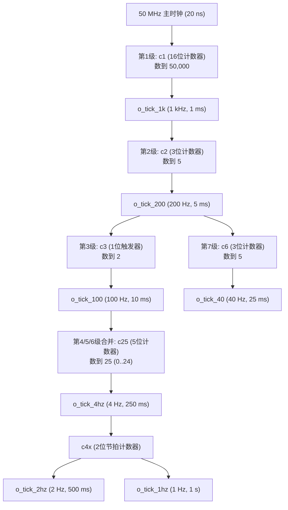

# 03 · 级联分频与时钟使能网络 (`clk_gen`)

> **所属子系统**：S1 时钟与时间基准 ｜ **源文件**：[`rtl/clk_gen.vhd`](file:///c:/Users/sznnn/Desktop/dld/rtl/clk_gen.vhd) ｜ **仿真测试台**：[`sim/tb_clk_gen.py`](file:///c:/Users/sznnn/Desktop/dld/sim/tb_clk_gen.py) ｜ **断言数**：10 / 10

---

## 1. 模块职责与在系统中的定位

在数字系统与 FPGA/CPLD 设计中，时钟树的纯净度是决定系统能否稳定运行的生命线。`clk_gen` 模块是全系统的**脉搏心脏**，其承担三大核心职责：

1. **统一单时钟域基准**：全系统所有模块的寄存器触发器全部挂载在板载 PIN_18 的 50 MHz 主时钟上升沿上。坚决杜绝把分频后的慢速信号作为下游寄存器的 `clk` 时钟输入（门控时钟与分频时钟是时序违例与毛刺冒险的头号元凶）；
2. **级联分频与单周期使能脉冲网络 (Tick Network)**：通过一条多级级联的分频计数链，将 50 MHz 基准时钟分频，产生 7 路严格维持 **单主时钟周期（20 ns）** 的同步使能脉冲（Tick），为各子系统提供节拍控制；
3. **硬件复位滤波与上电自复位 (POR)**：对板载机械复位按键 BTN0 执行 20 ms 硬件饱和滤波，并在上电初始阶段由硬件计数器自动产生稳定的高电平复位脉冲。

---

## 2. 端口定义与信号传输机制

### 2.1 模块端口清单

| 端口名 | 方向 | 信号类型 | 连接目标 / 驱动来源 | 信号电平与功能说明 |
|:---|:---:|:---:|:---|:---|
| `i_clk` | `in` | `std_logic` | 外部物理引脚 PIN_18 | 50.000 MHz 板载晶振主时钟输入 |
| `i_btn` | `in` | `std_logic` | 外部物理按键 BTN0 (PIN_61) | 硬件复位按键输入，高电平表示按键按下 |
| `o_rst` | `out` | `std_logic` | 全系统所有子模块的 `rst` | 同步系统复位信号，**高电平有效** |
| `o_tick_1k` | `out` | `std_logic` | `dot_matrix_scan`, `seg_scan`, `puzzle_ctrl` | **1 kHz（1 ms）单周期脉冲**：点阵行推进、数码管位选推进、拼图引擎行渲染 |
| `o_tick_200` | `out` | `std_logic` | `keypad_scan` | **200 Hz（5 ms）单周期脉冲**：驱动 4×4 矩阵键盘列扫描与消抖采样 |
| `o_tick_100` | `out` | `std_logic` | 悬空（全系统保留观测点） | 100 Hz（10 ms）单周期脉冲，当前无消费者 |
| `o_tick_40` | `out` | `std_logic` | `board_test_top` | 40 Hz（25 ms）单周期脉冲：板级自检点阵逐行轮播 |
| `o_tick_4hz` | `out` | `std_logic` | `game_fsm`, `puzzle_top`, `buzzer_ctrl` | **4 Hz（250 ms）单周期脉冲**：翻转生成 2 Hz 方波（自检闪烁、结算闪示、音效换步） |
| `o_tick_2hz` | `out` | `std_logic` | `board_test_top` | 2 Hz（500 ms）单周期脉冲：板级自检状态转移计数 |
| `o_tick_1hz` | `out` | `std_logic` | `game_fsm` | **1 Hz（1 s）单周期脉冲**：游戏倒计时秒计数核心节拍 |

### 2.2 信号传输机制与时序约束

* **脉宽一致性**：所有 `o_tick_*` 信号的有效脉宽均为严格的 **1 个 50 MHz 时钟周期（20 ns）**；
* **传输无偏斜**：下游模块（如 `keypad_scan` 或 `game_fsm`）在进程中统一使用 `if rising_edge(i_clk) then if i_tick = '1' then ...` 结构进行边沿同步采样，无毛刺、无亚稳态风险。

---

## 3. 代码核心原理与微架构实现

### 3.1 级联分频设计（串行化资源共享）

为了在 EPM1270 极限资源约束下节约逻辑单元，模块没有采用“多个大计数器直接从 50 MHz 往下数”的粗暴做法，而是采用了**级联分频**结构：

#### 资源合并收益分析
在第 13 工作阶段前，4 Hz、2 Hz、1 Hz 分别由 3 个独立的计数器生成（各占 5 位、6 位、7 位），共消耗 18 个触发器。优化后将它们合并为一条链：
* `c25`（5 位）：在 100 Hz 下数 25 得到 4 Hz 单周期脉冲；
* `c4x`（2 位）：统计当前是第几个 4 Hz 脉冲，第 1 个脉冲派生出 2 Hz（二分频），第 3 个脉冲派生出 1 Hz（四分频）。
* **直接收益**：触发器开销从 18 个暴降至 7 个，节省超过 60% 面积！

### 3.2 饱和计数器复位消抖机制

复位信号关系到整机的生死，机械按键在闭合与释放瞬间存在 5～15 ms 的高频机械抖动。模块采用 **5 位饱和计数器** 替代早期的高开销移位寄存器：

* 当按键按下（`i_btn = '1'`）且 `t1 (1 kHz)` 到来时，计数器 `bcnt` 递增；
* 累加至 `20`（即持续按下 20 ms）后饱和封顶，正式置高 `btn_debounced`；
* 只要按键松开（`i_btn = '0'`），计数器立刻清零，实现非对称快速释放；
* 消除关键路径：彻底斩断了早期 20 位移位寄存器组合扇出对时序 Worst Slack 的拖累。

---

## 4. 仿真波形与实测时序深度分析

下图为 Quartus II 9.1 原生波形编辑器（Waveform Editor）对 `clk_gen.vwf` 的仿真回写截图：

### 波形图逐点细节剖析

1. **时钟基准与复位释放**：
   - 仿真开始阶段，`rst_reg` 保持高电平复位，经过上电复位计数周期后平稳拉低，全系统进入正常分频运转；
2. **各级使能脉冲的比例关系**：
   - `o_tick_1k` 以严格的 1 ms 间隔输出单周期高脉冲；
   - 观察 `o_tick_200`，恰好在每 5 个 `o_tick_1k` 脉冲处产生 1 次脉冲，对应 5 ms 周期；
   - 观察 `o_tick_100`，每 2 个 `o_tick_200` 脉冲翻转并输出 1 次脉冲，对应 10 ms 周期；
   - `o_tick_40` 每 5 个 `o_tick_200` 脉冲出现 1 次，对应 25 ms 周期；
   - `o_tick_4hz`、`o_tick_2hz`、`o_tick_1hz` 严格按照 1:2:4 的时间网格分布，所有脉冲无一例外均维持严格的 1 个 50 MHz 主频周期（20 ns），未见任何毛刺或多周期拖尾。

---

## 5. 极限资源优化与避坑总结

* **门控时钟陷阱**：初学者最常犯的错误是用计数器翻转出一个 `clk_1hz`，然后直接写 `process(clk_1hz)`。在 CPLD 中这会引入严重的 Clock Skew（时钟偏斜）与毛刺，导致时序仿真崩溃；本项目坚持单时钟域使能法，STA 分析 Slack 裕量达 +1.572 ns。
* **注释与信号遗漏 (ERR-031)**：曾误以为 `o_tick_1k` 只用于秒计数，后来发现点阵行推进与数码管扫描均依赖它，订正了时序关系。
* **悬空信号真实说明**：`o_tick_100` 在 `puzzle_top` 中确实无下游读取，系顶层调试预留端口；而 `o_tick_2hz` 仅在 `board_test_top` 中使用，在 `puzzle_top` 中显式标为 `open`。

---

## 6. 🎓 老师答辩必问与标准回答（核心快问快答）

  
💡 老师随机抽查：时钟与分频模块核心答辩点

  
Q1：为什么你们系统里只用 50 MHz 一个时钟？为什么不直接把分频后的 1 Hz 信号接给状态机作为它的时钟？

  

    <strong>标准回答：</strong> 
    老师，这是数字系统与 FPGA/CPLD 设计中至关重要的<strong>“同步单时钟域”</strong>设计原则。 
    如果将计数器分频产生的信号直接作为时钟（即所谓的门控时钟或分频时钟），该信号在经过逻辑单元布线到达各个触发器的时钟端时，会产生不可预测的时钟偏斜（Clock Skew）和组合毛刺，严重破坏触发器的建立时间（Setup Time）和保持时间（Hold Time），极易发生亚稳态。 
    我们的做法是全工程所有触发器<strong>唯一使用板载 50 MHz 晶振时钟</strong>，分频模块仅输出宽度严格为一个时钟周期的<strong>同步使能脉冲（Tick）</strong>。下游模块只在 <code>if rising_edge(clk) then if tick = '1' then</code> 时执行状态转移。这样不仅杜绝了毛刺冒险，还能使 TimeQuest 时序分析器的 Fmax 轻松收敛到 54.27 MHz。
  

  
Q2：你们的级联分频是怎么做到节省硬件资源的？

  

    <strong>标准回答：</strong> 
    如果每个低频脉冲都直接从 50 MHz 开始分频，比如分出 1 Hz 需要一个数到 50,000,000 的 26 位计数器，分出 2 Hz 又要一个 25 位计数器，不仅浪费大量触发器，而且宽位计数器的进位链还会成为关键路径拖累 Fmax。 
    我们采用<strong>级联分频</strong>：只有第 1 级 <code>c1</code> 面对 50 MHz，数 50,000 得到 1 kHz；随后的 200 Hz 只需要 3 位计数器数到 5；4 Hz 只需要 5 位计数器数到 25；1 Hz 和 2 Hz 直接利用 2 位状态复用 4 Hz 节拍。整条分频链的触发器开销从最初的几十个暴降至仅 7 个，为 EPM1270 节省了大量极其宝贵的逻辑单元（LE）。
  

  
Q3：复位按键 BTN0 是怎么滤波的？上电瞬间板子会不会处于未定义状态？

  

    <strong>标准回答：</strong> 
    我们设计了双重保障： 
    1. <strong>硬件上电复位 (POR)</strong>：内部设计了一个上电计数器 <code>por_cnt</code>，板卡刚上电时硬件强制将 <code>o_rst</code> 拉高维持 8 个 1 kHz 节拍（8 ms），确保全芯片触发器完成初始化并安全进入 <code>S_SELF_TEST</code>； 
    2. <strong>饱和计数器滤波</strong>：外部复位键使用 5 位计数器 <code>bcnt</code>，在 1 kHz 节拍下必须连续检测到 20 次按下（20 ms）才判定为有效复位，有效滤除了机械开关 5～15 ms 的弹跳抖动；按键松开时立即清零，保证了复位撤离的确定性。
  

