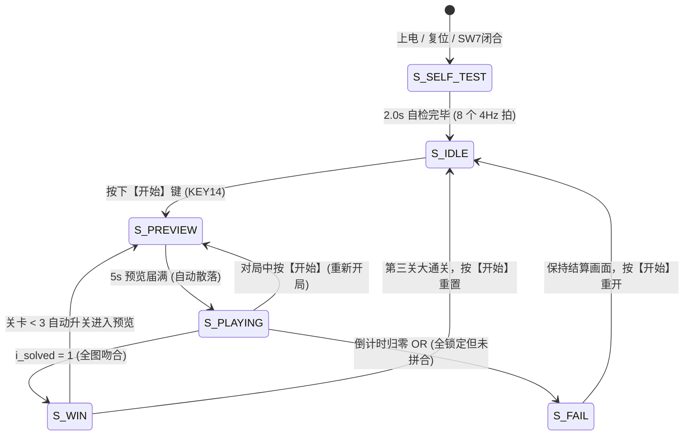

# 05 · 游戏主控与规则算法状态机 (`game_fsm`)

> **所属子系统**：S3 游戏控制 ｜ **源文件**：[`rtl/game_fsm.vhd`](file:///c:/Users/sznnn/Desktop/dld/rtl/game_fsm.vhd) ｜ **仿真测试台**：[`sim/tb_game_fsm.py`](file:///c:/Users/sznnn/Desktop/dld/sim/tb_game_fsm.py) ｜ **断言数**：30 / 30

---

## 1. 模块职责与在系统中的定位

`game_fsm` 是整机系统的**最高决策指挥中心**。它严格遵循硬件算法状态机（ASM, Algorithmic State Machine）规范设计，只掌管**“时间”与“决策”**，不干涉底层空间几何坐标计算（坐标平移与重叠判定交由 `puzzle_ctrl` 处理）。

其核心职责包括：
1. **全局生命周期流转**：管理开机自检（`S_SELF_TEST`）、待机（`S_IDLE`）、图案预览（`S_PREVIEW`）、游戏对局（`S_PLAYING`）、通关胜利（`S_WIN`）与超时失败（`S_FAIL`）六大核心状态；
2. **多关卡倒计时管理器**：提供精准秒计数（第一关 30 s、第二关 40 s、第三关 60 s、预览 5 s），并产生 2 Hz 闪烁标志；
3. **输入按键语义译码**：将键盘模块上报的原始物理按键编号（`0..15`）单点译码为游戏动作（开始、选择、上下左右、顺时针旋转、确认锁定）；
4. **引擎握手与音效事件调度**：在散落零片时与底层拼图引擎执行严格的请求/应答握手，并向音频发生器广播场景音效码。

---

## 2. 端口定义与信号传输机制

### 2.1 模块端口清单

| 端口名 | 方向 | 信号类型 | 连接模块 | 功能描述 |
|:---|:---:|:---:|:---|:---|
| `i_clk` | `in` | `std_logic` | `clk_gen` | 全局 50 MHz 主时钟基准 |
| `i_rst` | `in` | `std_logic` | `clk_gen` | 同步高电平复位 |
| `i_sw` | `in` | `std_logic` | PIN_121 (SW7) | 硬件开关，低电平时强制全系统静默全黑 |
| `i_tick_1hz` | `in` | `std_logic` | `clk_gen` | 1 Hz 游戏秒计数使能脉冲 |
| `i_tick_4hz` | `in` | `std_logic` | `clk_gen` | 4 Hz 脉冲，内部翻转生成 2 Hz、50% 占空比方波 |
| `i_press` | `in` | `std_logic` | `keypad_scan` | 单时钟周期的按键有效触发脉冲 |
| `i_key` | `in` | `std_logic_vector(3 downto 0)` | `keypad_scan` | 4 位原始物理按键索引 |
| `o_sel` | `out` | `std_logic` | `puzzle_ctrl` | 单拍脉冲：循环轮选当前活动零片 |
| `o_move` | `out` | `std_logic` | `puzzle_ctrl` | 单拍脉冲：零片平移请求 |
| `o_conf` | `out` | `std_logic` | `puzzle_ctrl` | 单拍脉冲：确认锁定当前活动零片 |
| `o_rot` | `out` | `std_logic` | `puzzle_ctrl` | 单拍脉冲：触发 90° 顺时针正交旋转 |
| `o_go` | `out` | `std_logic` | `puzzle_ctrl` | **电平信号**：触发零片散落请求（握手信号） |
| `i_shuf_busy`| `in` | `std_logic` | `puzzle_ctrl` | 拼图引擎散落正忙应答 |
| `o_up/down/left/right` | `out` | `std_logic` | `puzzle_ctrl` | 平移方向指示（高电平有效） |
| `o_level` | `out` | `std_logic` | 各子模块 | `'0'` = 第一关，`'1'` = 第二/三关 |
| `o_lvl3` | `out` | `std_logic` | 各子模块 | `'1'` = 处于第三关 |
| `o_state` | `out` | `std_logic_vector(2 downto 0)` | `puzzle_top`, `disp_format` | 3 位状态编码，告知整机当前所处阶段 |
| `o_time` | `out` | `std_logic_vector(5 downto 0)` | `disp_format` | 6 位倒计时秒数（`0..63`） |
| `o_blink` | `out` | `std_logic` | `disp_format`, `puzzle_top` | 2 Hz 方波翻转标志 |
| `i_solved` | `in` | `std_logic` | `puzzle_ctrl` | 拼图完成标志（全图 100% 重合） |
| `i_all_lock`| `in` | `std_logic` | `puzzle_ctrl` | 全部零片已锁定标志 |
| `o_sound` | `out` | `std_logic_vector(3 downto 0)` | `buzzer_ctrl` | 4 位音效场景码（16 个音效事件） |

---

## 3. 代码核心原理与微架构实现

### 3.1 状态机 ASM 转移流程

主状态机包含 6 个核心状态，其 ASM 状态转移流程图如下所示：

### 3.2 关卡编码的“零比较器”时序优化

需求 A2 要求增加第三关并从图库随机抽取。最直观的写法是将 `o_level` 扩展为 2 位 `std_logic_vector(1 downto 0)`（`"00"`=关1, `"01"`=关2, `"10"`=关3）。
但在 99% 的极限利用率下实测发现：
* 直接改宽总线导致下游 `piece_rom`、`pattern_rom` 和 `puzzle_ctrl` 前端各自插入了一级宽比较器；
* Quartus II 综合后的 **Fmax 从 48.87 MHz 直降到 46 MHz 以下**，时序严重恶化！
* **优化策略**：保持原有的 1 位 `o_level`（`'0'`=第一关，`'1'`=二/三关）**一个触发器都不动**，仅额外增加一个 1 位的第三关独立标志 `o_lvl3`。下游模块仅在必要时感知 `o_lvl3`，使得整机 Fmax 稳定收敛在 54.27 MHz！

### 3.3 散落触发的“电平握手”机制 (ERR-006 / ERR-024)

在早期版本中，`o_go` 采用单脉冲输出。但仿真与上板暴露了严重缺陷：
1. **重复散落 (ERR-006)**：如果 `o_go` 是单脉冲，当引擎在忙散落时按键再次按下，由于无状态记忆，引擎散落完成后可能被二次触发；
2. **残余状态假判决 (ERR-024)**：新一局刚开始时，底层引擎的 `i_solved` 仍然保留上一局通关的残留 `'1'`，若单脉冲未彻底同步，状态机会瞬间误判过关！
3. **闭环解法**：`o_go` 改为**长电平握手**：状态机拉高 `o_go` 维持高电平，直到感知到底层引擎反馈 `i_shuf_busy = '1'`，才撤销 `o_go`；且在 `i_shuf_busy` 恢复为 `'0'` 之前，状态机彻底屏蔽任何过关或移动判决。

---

## 4. 仿真波形与实测时序深度分析

下图为 Quartus II 9.1 原生波形编辑器中对 `game_fsm.vwf` 的仿真结果截图：

### 波形图逐点细节剖析

1. **自检阶段 (S_SELF_TEST)**：
   - 信号 `o_state = 000`。内部自检计数器精确计数 8 个 `i_tick_4hz` 脉冲（恰好持续 2.000 秒）；
   - 在此期间，`o_blink` 呈现周期为 500 ms（2 Hz）、占空比严格 50% 的方波；
2. **待机阶段 (S_IDLE)**：
   - 自检结束后，`o_state` 自动切为 `001`（待机）。点阵熄灭，数码管显示当前关卡，等待玩家按键；
3. **预览倒计时 (S_PREVIEW)**：
   - 注入 `i_press = '1'` 且 `i_key = 1`（【开始】键），状态机进入 `010`（预览）；
   - 观察 `o_time`，从 `5` 伴随 `i_tick_1hz` 严格逐秒递减（5 → 4 → 3 → 2 → 1）；
4. **散落与对局 (S_PLAYING)**：
   - 倒计时减至 0 时，`o_go` 瞬间拉高触发散落，随后切入 `011`（对局），`o_time` 重新装载为第一关限时 `30` 秒；
   - 注入方向键脉冲，观察到 `o_move` 与对应的方向引脚同步拉高一个时钟周期；
5. **过关判决 (S_WIN)**：
   - 模拟拼图完成信号 `i_solved = '1'` 拉高，状态机下一拍立即切入 `100`（过关）；`o_sound` 广播通关号角码，关卡标志 `o_level` 自动翻转准备进入第二关。

---

## 5. 极限资源优化与工程避坑

* **对局态底图置零害死新判据 (ERR-023)**：
  - 早期版本在切入 `S_PLAYING` 时为了清空预览画面，错误地把喂给拼图引擎的目标图案全赋为 0，导致底层比对模块一直在和全黑画面比对，永远判定失败。通过将“显示通道”与“引擎参考通道”解耦修复。
* **结算画面防刷机制 (S5)**：
  - 胜利或失败时，结算画面首先以 2 Hz 闪烁 2 个周期（1 秒）吸引注意，随后常亮定格，等待玩家按【开始】键确认后才开始新局，杜绝了误触闪退。

---

## 6. 🎓 老师答辩必问与标准回答（核心快问快答）

  
💡 老师随机抽查：主控制状态机核心答辩点

  
Q1：请介绍一下你们状态机的 6 个状态，以及它们是如何流转的？

  

    <strong>标准回答：</strong> 
    老师，我们的状态机严格按照 ASM 算法状态机分为 6 个核心状态： 
    1. <strong>S_SELF_TEST（开机自检）</strong>：上电或按复位进入，固定停留 2.0 秒，点阵与数码管以 2 Hz 闪烁，蜂鸣器奏响 POST 短鸣； 
    2. <strong>S_IDLE（待机态）</strong>：数码管提示当前关卡，按【开始】键进入预览； 
    3. <strong>S_PREVIEW（预览态）</strong>：点阵全红显示目标图案，倒计时 5 秒，限时结束自动散落零片； 
    4. <strong>S_PLAYING（对局态）</strong>：装载 30s/40s/60s 倒计时，响应玩家上下左右平移、90° 旋转与切换零片；倒计时 ≤10s 时触发绿色 2 Hz 告急幽灵； 
    5. <strong>S_WIN（通关态）</strong>：当底层引擎反馈 100% 吻合时进入，数码管显示 PASS，自动升关；第三关胜利进入大通关； 
    6. <strong>S_FAIL（失败态）</strong>：超时归零或错拼锁定进入，数码管显示 FAIL，保持画面等待玩家按【开始】重开。
  

  
Q2：在增加第三关（A2）时，你们为什么没有直接把关卡信号改成 2 位宽的 std_logic_vector(1 downto 0)？

  

    <strong>标准回答：</strong> 
    老师，这是一个经过实测数据支撑的<strong>极限时序优化裁决</strong>。 
    如果在 EPM1270 占用率已达 98% 的情况下将 <code>o_level</code> 改为 2 位，下游的 <code>piece_rom</code>、<code>pattern_rom</code> 和 <code>puzzle_ctrl</code> 的解码输入都会增加 1 位，Quartus 会插入多级级联比较器，实测会导致系统 Fmax 从 48.87 MHz 跌落到 46 MHz 以下，面临违例风险。 
    我们保留了原有的 1 位 <code>level</code> 信号，并单独增加一个独立的 <code>lvl3</code> 标志，下游模块的既有查找路径完全保持不变，以零时序代价完美达成了三关连闯功能。
  

  
Q3：如果游戏中玩家想重新开始，或者不小心按了开始键，状态机会怎么处理？

  

    <strong>标准回答：</strong> 
    我们在 <code>S_PLAYING</code>、<code>S_WIN</code> 和 <code>S_FAIL</code> 状态下均对【开始】键（KEY14）做了全生命周期监听（符合基础要求 B11）。 
    无论何时按下【开始】键，状态机都会立刻复位内部倒计时与底层引擎，回到 <code>S_PREVIEW</code> 重新开始当前关卡，绝不会发生状态锁死或跑飞。
  

