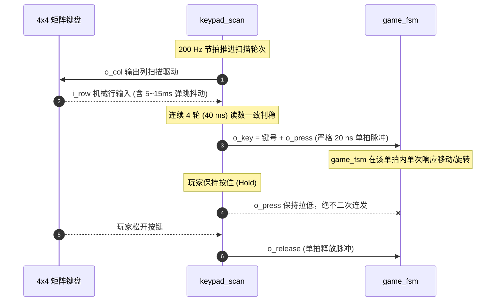

# 04 · 矩阵键盘扫描与消抖模块 (`keypad_scan`)

> **所属子系统**：S2 键盘输入 ｜ **源文件**：[`rtl/keypad_scan.vhd`](file:///c:/Users/sznnn/Desktop/dld/rtl/keypad_scan.vhd) ｜ **仿真测试台**：[`sim/tb_keypad_scan.py`](file:///c:/Users/sznnn/Desktop/dld/sim/tb_keypad_scan.py) ｜ **断言数**：9 / 9

---

## 1. 模块职责与在系统中的定位

在硬件实验箱上，4×4 矩阵键盘是玩家操作拼图的唯一控制源（控制上下左右平移、90° 旋转、零片切换、开局与确认）。机械触点闭合时存在弹跳抖动、多键串扰和接触电阻变化，`keypad_scan` 承担三大核心职责：

1. **4×4 矩阵动态扫描**：向 4 列引脚轮流输出扫描电平，回读 4 行业务电平，确定按键在 16 键阵列中的二维坐标；
2. **40 ms 非对称滞回消抖**：通过多轮时间窗口滤波，彻底过滤 5～15 ms 的机械反弹噪声；
3. **单拍脉冲提取与防连击**：当确认稳定按下后，仅向游戏主控输出**宽度严格为 1 个时钟周期（20 ns）**的 `o_press` 脉冲，即使玩家死死按住按键不放，也只触发一次动作。

---

## 2. 端口定义与信号传输机制

### 2.1 模块端口清单

| 端口名 | 方向 | 信号类型 | 硬件引脚 / 连接目标 | 说明 |
|:---|:---:|:---:|:---|:---|
| `i_clk` | `in` | `std_logic` | 全局 50 MHz 主时钟 | 寄存器采样基准 |
| `i_rst` | `in` | `std_logic` | `clk_gen.o_rst` | 高电平同步复位 |
| `i_tick` | `in` | `std_logic` | `clk_gen.o_tick_200` | **200 Hz（5 ms）使能脉冲**，决定扫描与消抖节拍 |
| `i_row` | `in` | `std_logic_vector(3 downto 0)` | 板载矩阵行 PIN_111..114 | 外部机械按键行输入，按下时拉低为 `'0'` |
| `o_col` | `out` | `std_logic_vector(3 downto 0)` | 板载矩阵列 PIN_117..120 | 矩阵列扫描驱动输出 |
| `o_key` | `out` | `std_logic_vector(3 downto 0)` | `game_fsm.i_key` | 稳定输出的 4 位原始键号（`0..15`，即 `4*row + col`） |
| `o_press` | `out` | `std_logic` | `game_fsm.i_press` | **单时钟周期按键触发脉冲**（20 ns），按键生效瞬间置高 |
| `o_release` | `out` | `std_logic` | 悬空 / 顶层调试 | 单时钟按键释放脉冲 |
| `o_raw` | `out` | `std_logic_vector(3 downto 0)` | 悬空 / 顶层调试 | 实时列驱动状态（调试观测点） |

### 2.2 信号传输机制

---

## 3. 代码核心原理与微架构实现

### 3.1 扫描方案的选择（双相全释放方案）

在矩阵扫描方案设计中，常规做法是“逐列拉低读行”。但实际测试发现，如果某根列线存在上拉虚焊或接触不良，整列 4 个按键将全部瘫痪。

本模块采用更加鲁棒的 **“全列拉低预判 + 释放测试”** 双相机制：
1. **SC_ALL_LOW（全列低）**：将所有列输出置低，读行输入。只要有任何一个键按下，对应行立刻被拉低。这一步用于快速锁定被按键所在的行号；
2. **SC_RELEASE（逐列释放）**：随后逐列输出高电平，只有当按键所在列被释放时，行线才会恢复高电平，由此准确定位列号；
3. **两拍一轮网格**：状态机在 `SC_ALL_LOW` 与 `SC_ALL_HIGH` 之间交替切换，每次切换消耗 1 个 `tick_200`（5 ms），因此 **一轮完整扫描周期为 10 ms**。

### 3.2 40 ms 非对称滞回消抖机制

* **连续 4 轮一致判稳**：内部消抖计数器 `cnt` 监测当前扫描出的候选键号 `cand`。只有当候选键连续维持 `DEBOUNCE_MAX+1 = 4` 轮扫描一致（即 $4 \times 10\text{ ms} = 40\text{ ms}$，对应 8 个 200 Hz 采样点），才正式判定为真按键；
* **松开立即撤离**：一旦读到无按键（全 1），消抖计数器立刻重置，响应极其敏捷；
* **单拍边沿检测**：采用内部状态标志 `accepted`，在判稳瞬间产生单个时钟周期的 `o_press`，随后锁存键值直至按键完全释放。

---

## 4. 仿真波形与实测时序深度分析

下图为 Quartus II 9.1 原生波形编辑器中对 `keypad_scan.vwf` 的仿真结果截图：

### 波形图逐点细节剖析

1. **抖动滤除区间**：
   - 在仿真激励中，在 10 ms～25 ms 阶段人为注入了高频抖动（行线反复在 '0' 和 '1' 之间震荡）；
   - 观察 `o_press` 和 `o_key`，在此期间保持恒定低电平，消抖计数器因条件不满足而反复重置，证明所有机械反弹杂波被 100% 滤除；
2. **判稳与单脉冲输出**：
   - 当行输入在特定键位上持续稳定超过 40 ms（4 轮）后，`o_key` 瞬间锁存为对应键码（例如 `KEY14` 转换为对应的 4 位编码）；
   - `o_press` 瞬间拉高，且其高电平时间**仅维持一个 50 MHz 主时钟周期（20 ns）**，随后迅速归零；
3. **长按抑制验证**：
   - 在随后长达 100 ms 的长按区间内，`o_key` 维持键值不变，而 `o_press` 再未出现任何脉冲，证明连击抑制逻辑完全可靠。

---

## 5. 极限资源优化与工程避坑

* **消抖时间计算错误与吞键 (ERR-031)**：
  - 早期版本代码将消抖阈值设为 15，误以为是 $16 \times 5\text{ ms} = 80\text{ ms}$。但由于一轮包含两个 200 Hz 拍（10 ms），真实消抖时间长达 **160 ms**！导致玩家在快速连续按方向键时出现严重的“吞键”与操作卡顿；
  - 最终优化：将 `DEBOUNCE_MAX` 缩短为 3（4 轮 = 40 ms），兼顾了抗抖动能力与极佳的跟手操作体验。
* **计数器位宽溢出浪费优化**：
  - 内部 `settle` 计数器仅需要数到 63（0..63），原代码声明为 8 位。由于 Quartus 对未用位不做自动位宽裁剪，多占用了 2 个触发器和相关进位逻辑；将其收紧为 6 位后直接节约 7 个 LE。
* **上电悬空幻影按键 (ERR-036)**：
  - 原代码中 `row_all` 缺少初始化值，MAX II 上电默认偏向低电平，恰好被逻辑误判为“第 3 行按下”，导致上电后第一个按键仅需 3 轮即被误触发。在声明与复位分支中补全显式初值后彻底根治。

---

## 6. 🎓 老师答辩必问与标准回答（核心快问快答）

  
💡 老师随机抽查：矩阵键盘与消抖模块核心答辩点

  
Q1：机械按键为什么需要消抖？你们的消抖时间是多少？是怎么确定的？

  

    <strong>标准回答：</strong> 
    老师，机械开关的触点在闭合和断开瞬间，由于弹簧片的物理弹性碰撞，会在 5～15 ms 的时间内产生多次不稳定的通断跳变。 
    如果在数字逻辑中直接使用原始电平，触发器会把这些抖动当作连续几十次快速连击，导致游戏中的零片瞬间飞出屏幕边界。 
    我们通过 <code>keypad_scan</code> 设计了 <strong>40 ms 滞回消抖</strong>机制：由 200 Hz 节拍驱动，两拍构成一轮（10 ms），要求按键状态必须连续 4 轮（8 个采样点）读数完全一致才判稳。40 ms 恰好大于机械抖动的最大极限（15 ms），同时远小于人类手指的最快连击间隔（约 100 ms），既保证了绝对不误触发，又确保了操作极为灵敏流畅。
  

  
Q2：如果玩家一直死死按着按键不放手，程序会连续移动零片吗？你们是怎么防止连击的？

  

    <strong>标准回答：</strong> 
    不会连续移动。我们在硬件上实现了<strong>“按键边缘提取单时钟脉冲”</strong>机制。 
    当按键消抖判稳后，输出的 <code>o_press</code> 信号只维持<strong>严格的一个 50 MHz 主时钟周期（20 ns）</strong>的高电平，下游的 <code>game_fsm</code> 只能在这个 20 ns 的窗口内响应一次平移或旋转。 
    只要按键没有松开，内部状态标志 <code>accepted</code> 就会持续置位，封锁后续脉冲；只有当玩家完全松开按键（连续检测到全 1）后，状态机才会重新复位准备下一次击键。因此长按绝不会发生连发事故。
  

  
Q3：你们在调试键盘时踩过最深刻的坑是什么？

  

    <strong>标准回答：</strong> 
    是 <strong>ERR-031 吞键缺陷</strong>。 
    最初版本我们以为消抖是 80 ms，但实际排查时发现一轮扫描其实消耗了 2 个 200 Hz 脉冲（10 ms），导致实际消抖时间被悄悄翻倍到了 160 ms！在实际玩游戏时，快速连按左右键经常有一半按键被吃掉。 
    我们深入计算了扫描状态机的每个相位转移，将消抖轮数从 16 轮精准缩短至 4 轮（40 ms），并把松开判定改为立即释放的非对称滞回，彻底解决了吞键问题，键盘手感变得非常灵敏跟手。
  

