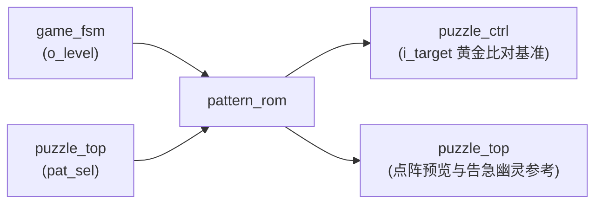

# 07 · 关卡目标图案固化库 (`pattern_rom`)

> **所属子系统**：S5 固化图库与随机源 ｜ **源文件**：[`rtl/pattern_rom.vhd`](file:///c:/Users/sznnn/Desktop/dld/rtl/pattern_rom.vhd) ｜ **仿真测试台**：[`sim/tb_pattern_rom.py`](file:///c:/Users/sznnn/Desktop/dld/sim/tb_pattern_rom.py) ｜ **断言数**：8 / 8

---

## 1. 模块职责与在系统中的定位

<div class="plain-explain-box">
  💡 <strong>大白话一句话理解本模块</strong>：<br>
  它是整个游戏关卡题目的<strong>“标准答案题库与参考底图库”</strong>。由于芯片内部没有专用 RAM 内存块，它采用纯组合逻辑门电路，将第一关的 12 格实心矩形和第二/三关的 4 幅 16 格高难度图案（田、十字、SZ、阶梯）直接固化在硬件中。主控只要给出关卡编号和随机索引，它在一纳秒内就能并行吐出标准答案，供点阵屏预览和拼图引擎做终局吻合对比。
</div>

`pattern_rom` 是系统中的**关卡黄金参考标准库**。它采用纯组合逻辑查找表实现，不占用任何时钟触发器，专门为游戏主控、显示多路器和拼图引擎提供不可篡改的关卡目标图形基准。

核心职责包括：
1. **第一关基准目标输出**：严格按照实验任务书【题】图 4-1 输出 12 格矩形目标图案；
2. **第二/三关高级图案库管理 (A2/S1)**：存储 4 幅高难度 16 格全连通几何图案（田、十字、SZ、阶梯）；
3. **确定性与随机性双通道支持**：第二关固定输出阶梯图案（B10 要求），第三关由伪随机源在 4 幅图库中动态抽取（A2 要求）。

---

## 2. 端口定义与信号传输机制

### 2.1 模块端口清单

| 端口名 | 方向 | 信号类型 | 连接目标 | 功能描述 |
|:---|:---:|:---:|:---|:---|
| `i_level` | `in` | `std_logic` | `game_fsm.o_level` | 关卡选择：`'0'` = 第一关，`'1'` = 第二/三关 |
| `i_pat` | `in` | `std_logic_vector(1 downto 0)` | `puzzle_top.pat_sel` | 2 位图案库索引（只对第二/三关生效） |
| `o_mask` | `out` | `std_logic_vector(63 downto 0)` | `puzzle_ctrl`, `puzzle_top` | 64 位宽目标图案平面位图（`'1'` 为目标点亮格） |

### 2.2 信号传输机制



---

## 3. 代码核心原理与微架构实现

### 3.1 纯组合逻辑与面积零消耗

在 FPGA/CPLD 中，固定图案无需消耗 Block RAM 或分布式 RAM。`pattern_rom` 内部采用纯粹的并行赋值（`when-else`）：
```vhdl
o_mask <= L1_TARGET_MASK when (i_level = '0')
          else L2_PATS(to_integer(unsigned(i_pat)));
```
综合工具直接将其映射为少量的 4 输入查找表（LUT），在极小面积内实现零延时瞬间译码。

### 3.2 几何图案严格数学约束

图案库并非随意绘制的涂鸦，而是由专用几何验证脚本（[`scripts/check_geometry.py`](file:///c:/Users/sznnn/Desktop/dld/scripts/check_geometry.py)）通过数学穷举严格证明的：
1. **面积严格守恒**：
   - 第一关矩形：宽 4 × 高 3 = **12 格**（与第一关 3 块零片 $3 + 6 + 3 = 12$ 绝对守恒）；
   - 第二/三关图案：4 幅图每幅均严格等于 **16 格**（与 4 块异形零片 $3 + 2 + 5 + 6 = 16$ 绝对守恒）；
2. **连通性与无空洞**：4 幅图案全部为单连通区域，没有任何孤立噪点或内闭空洞；
3. **绝对可铺性证明**：脚本穷举验证证明，这 4 幅图案全部能被第二关的 4 块异形零片在**仅允许平移（无需旋转）**的前提下完美铺满！

---

## 4. 仿真波形与实测时序深度分析

下图为 Quartus II 9.1 原生波形编辑器中对 `pattern_rom.vwf` 的仿真回写截图：


### 波形图逐点细节剖析

1. **第一关图案输出**：
   - 当 `i_level = '0'` 时，无论 `i_pat` 是 `00`, `01`, `10` 还是 `11`，输出 `o_mask` 恒定锁定为 `L1_TARGET_MASK`（12 格实心矩形），不受低 2 位干扰；
2. **第二/三关图案切换**：
   - 当 `i_level = '1'` 时，随着 `i_pat` 从 `00` 切换到 `11`，`o_mask` 依次输出田字形、十字形、SZ形和阶梯形图案；
   - 信号切换无任何毛刺，且所有输出掩码的汉明重（置 1 的比特数）在第一关严格为 12、第二/三关严格为 16。

---

## 5. 极限资源优化与工程避坑

* **对局态底图丢失事故 (ERR-023)**：
  - 早期开发中，顶层曾误将对局态的目标图案屏蔽掉，导致拼图引擎在比对时参考基准全为 0。本模块通过在顶层为 `puzzle_ctrl` 建立独立的参考直通总线，确保无论显示多路器如何切换，引擎参考基准永不掉线。

---

## 6. 🎓 老师答辩必问与标准回答（核心快问快答）

<div class="defense-box">
  <div class="defense-title">💡 老师随机抽查：目标图案库核心答辩点</div>

  <div class="defense-q">Q1：你们的关卡目标图案保存在哪里？占用了多少 RAM 存储器？</div>
  <div class="defense-a">
    <strong>标准回答：</strong><br>
    老师，我们使用的 Altera MAX II EPM1270 芯片内部是<strong>没有嵌入式 Block RAM</strong> 的。<br>
    我们的 5 幅目标图案是作为常量阵列（<code>constant array</code>）固化在设计包 <code>puzzle_pkg</code> 中的，在 <code>pattern_rom</code> 模块内通过纯组合逻辑的多路选择器直接输出。<br>
    Quartus 综合器会把这些常量直接吸收进布线网表的查找表（LUT）中，<strong>既不占用任何触发器，也不消耗任何 RAM</strong>，访问延时几乎为零。
  </div>

  <div class="defense-q">Q2：你们是怎么保证第二关和第三关随机抽取的图案一定能被零片拼出来的？万一无解怎么办？</div>
  <div class="defense-a">
    <strong>标准回答：</strong><br>
    绝不会出现无解的情况。<br>
    我们在硬件编码前专门编写了 Python 离散几何验证脚本 <code>scripts/check_geometry.py</code>，对 4 幅图案进行了全状态空间穷举搜索证明：<br>
    1. <strong>面积守恒</strong>：四块异形零片面积分别为 3、2、5、6 格，总和恰好等于图案的 16 格；<br>
    2. <strong>数学可铺满性</strong>：脚本穷举证明，田字、十字、SZ 和阶梯图案不仅有解，而且在<strong>仅允许平移、不旋转</strong>的前提下就至少存在 1 种合法的绝对铺满摆法。因此图案库在数学上是绝对安全且严谨的。
  </div>
</div>
