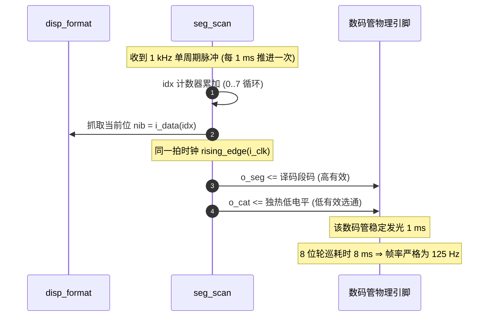

# 11 · 数码管 125 Hz 无频闪扫描驱动 (`seg_scan`)

> **所属子系统**：S6 多通道音画输出 ｜ **源文件**：[`rtl/seg_scan.vhd`](file:///c:/Users/sznnn/Desktop/dld/rtl/seg_scan.vhd) ｜ **仿真测试台**：[`sim/tb_seg_scan.py`](file:///c:/Users/sznnn/Desktop/dld/sim/tb_seg_scan.py) ｜ **断言数**：12 / 12

---

## 1. 模块职责与在系统中的定位

<div class="plain-explain-box">
  💡 <strong>大白话一句话理解本模块</strong>：<br>
  它是 8 位数码管的<strong>“高速轮流点亮开关与防残影管家”</strong>。板子上的 8 个数码管段笔画线是完全并联在一起的，无法同时通电显示不同的数字。本模块利用人类眼睛的视觉暂留效应，以 1 kHz 的节拍轮流点亮每一位（整屏刷新率高达 125 Hz，一秒钟轮转 125 圈）。人眼根本察觉不到切换，看起来就如同 8 个数码管同时常亮，而且由于段码与位选在同一时钟纳秒级同步切换，画面绝对没有一丝重影与暗光。
</div>

`seg_scan` 是系统中 8 位共阴极数码管的**物理层动态扫描显示驱动核**。由于实验板上的 8 个数码管段线全部并联、共阴极独立，模块必须通过高频时分复用轮流点亮每一位。

核心职责包括：
1. **8 位时分复用动态扫描**：在 1 kHz 节拍驱动下循环轮询 8 个共阴极引脚；
2. **125 Hz 超临界无频闪刷新**：将每位数码管的刷新率稳定在 125 Hz，彻底超越人眼视觉暂留闪烁极限；
3. **段选/位选同拍寄存（杜绝重影）**：段码与位选在同一系统时钟上升沿同步锁存，无需死区消隐相位即可根绝拖尾残影。

---

## 2. 端口定义与信号传输机制

### 2.1 模块端口清单

| 端口名 | 方向 | 信号类型 | 硬件引脚绑定 | 信号电平与功能说明 |
|:---|:---:|:---:|:---|:---|
| `i_clk` | `in` | `std_logic` | PIN_18 | 全局 50 MHz 主时钟 |
| `i_rst` | `in` | `std_logic` | `clk_gen` | 高电平同步复位 |
| `i_tick` | `in` | `std_logic` | `clk_gen.o_tick_1k` | **1 kHz（1 ms）位推进脉冲** |
| `i_en` | `in` | `std_logic` | `game_fsm` | 全局使能：`'0'` 时强制共阴极全高（全灭） |
| `i_data` | `in` | `std_logic_vector(31 downto 0)` | `disp_format` | 8 个数码管的 4 位 BCD 数据总线 |
| `i_blank` | `in` | `std_logic_vector(7 downto 0)` | `disp_format` | 8 位消隐控制（`'1'` 为该位强制熄灭） |
| `o_seg` | `out` | `std_logic_vector(7 downto 0)` | AA..AP (PIN_62,59,58,57,55,53,52,51) | 8 段段选驱动，**高电平点亮**（bit7 为小数点 AP） |
| `o_cat` | `out` | `std_logic_vector(7 downto 0)` | CAT0..CAT7 (PIN_63..70,30,31) | 8 位共阴极选通，**低电平有效选通** |

### 2.2 信号传输机制



---

## 3. 代码核心原理与微架构实现

### 3.1 刷新率演化与临界闪烁频率 (ERR-027)

在早期版本中，动态扫描由 200 Hz 脉冲驱动：
* 8 个数码管轮流点亮一次需要：$8 \times 5\text{ ms} = 40\text{ ms}$；
* 整屏刷新率仅为：$1 / 40\text{ ms} = \mathbf{25\text{ Hz}}$；
* **严重缺陷**：人眼的视觉暂留临界融合频率（Critical Flicker Frequency, CFF）约为 60 Hz。25 Hz 远低于该阈值，在实验箱上用肉眼能观察到剧烈、恼人的抖动与闪烁！
* **优化措施**：顶层将位选推进时钟全面切换为 **1 kHz**：
  $$\text{刷新率} = \frac{1000\text{ Hz}}{8} = \mathbf{125\text{ Hz}}$$
* 125 Hz 处于超临界安全区间，人眼感知到的发光极其柔和稳定，彻底杜绝了肉眼频闪。

### 3.2 为什么不需要“消隐死区”也能杜绝重影？

很多传统单片机在扫描数码管时，必须先关断所有位选、换段码、再开启新位选，否则会产生严重的串光重影。
在 FPGA 中，我们通过**寄存器同拍更新**彻底消除了死区需求：
```vhdl
process (i_clk)
begin
    if rising_edge(i_clk) then
        seg_r <= decoded;   -- 段码寄存
        cat_r <= cat_sel;   -- 位选寄存
    end if;
end process;
```
由于 `o_seg` 与 `o_cat` 挂载在同一个 50 MHz 主时钟的上升沿，二者的引脚状态在 **同一个纳秒级别瞬间切换**。任何一位数码管都不会在旧段码下被点亮，完全不需要额外消耗计数器去制造消隐死区，省电且省面积！

---

## 4. 仿真波形与实测时序深度分析

下图为 Quartus II 9.1 原生波形编辑器中对 `seg_scan.vwf` 的仿真回写截图：


### 波形图逐点细节剖析

1. **位选循环与独热低电平**：
   - 观察 `o_cat` 输出总线，呈现严格的循环左移独热低电平（`11111110` → `11111101` → ... → `01111111`）；
   - 每个低电平脉冲的持续时间恰好为 1.000 ms，与 1 kHz 节拍严格对应；
2. **段码同步切换验证**：
   - 观察 `o_seg`，在 `o_cat` 发生跳变的同时，段码瞬间刷新为对应位置的字符编码，无任何提前或滞后；
3. **消隐位 (i_blank) 截断能力**：
   - 当扫描到被消隐的数码管位时，`o_cat` 保持全 `1`，即使段线上有数据也不构成回路，确保对应位完全熄灭。

---

## 5. 极限资源优化与避坑总结

* **引脚位序颠倒导致小数点误亮历史故障**：
  - 第一版代码曾误将段码高低位颠倒（把 AA 放在最高位，AP 小数点放在最低位），导致逻辑上的段 'a' 接到了物理小数点 PIN_51 上。实测时数字 "2" 顶横缺失，小数点却异常点亮。本模块在代码中建立了严格的常量映射表，彻底固化位序。

---

## 6. 🎓 老师答辩必问与标准回答（核心快问快答）

<div class="defense-box">
  <div class="defense-title">💡 老师随机抽查：数码管扫描驱动核心答辩点</div>

  <div class="defense-q">Q1：数码管扫描的刷新频率是多少？为什么不会闪烁？</div>
  <div class="defense-a">
    <strong>标准回答：</strong><br>
    老师，我们的数码管扫描刷新频率是严格的 <strong>125 Hz</strong>。<br>
    我们驱动扫描的使能脉冲是 1 kHz（1 ms 选通一位），8 个数码管轮流点亮一圈耗时 8 ms，换算成整屏刷新率恰好是 \(1000 / 8 = 125\text{ Hz}\)。<br>
    根据人眼生理视觉暂留特性，人眼的临界闪烁融合频率（CFF）大约在 60 Hz 左右。125 Hz 远高于人眼的闪烁感知极限，因此在实验箱上看起来非常稳定、明亮且毫无频闪。早期版本我们曾用 200 Hz 扫描（帧率 25 Hz），肉眼可见闪烁，后来全面升级为 1 kHz 彻底根治。
  </div>

  <div class="defense-q">Q2：在动态扫描时，数码管为什么没有出现相邻位的重影或鬼影？</div>
  <div class="defense-a">
    <strong>标准回答：</strong><br>
    很多嵌入式单片机出现鬼影是因为“位选切换与段码切换不同步”。<br>
    在我们的硬件设计中，段码输出寄存器 <code>seg_r</code> 和位选共阴极寄存器 <code>cat_r</code> 全部挂载在板载 <strong>50 MHz 主时钟的同一上升沿</strong>。<br>
    当从第 1 位切到第 2 位时，段码和位选在同一个时钟周期（20 ns）内瞬间完成原子性同步翻转，绝不会出现“第 2 位的位选开了，段线上还残留着第 1 位的段码”的情况，因此不需要浪费死区时间就能做到绝对无重影。
  </div>
</div>
