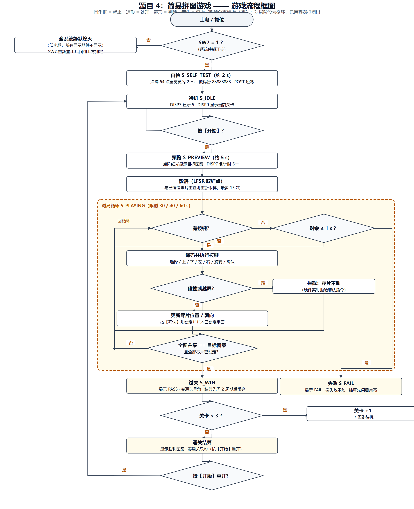
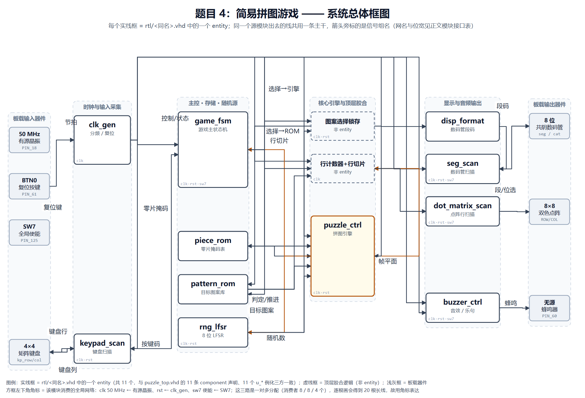
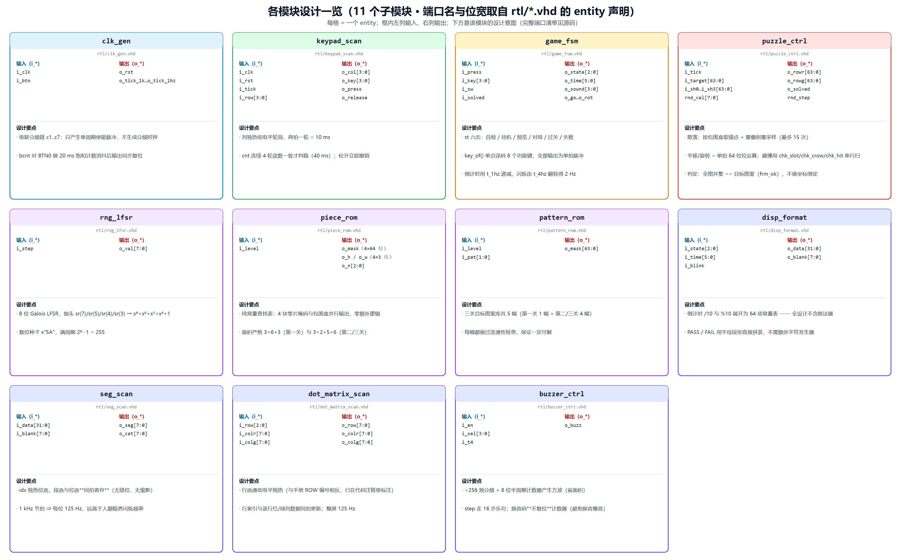
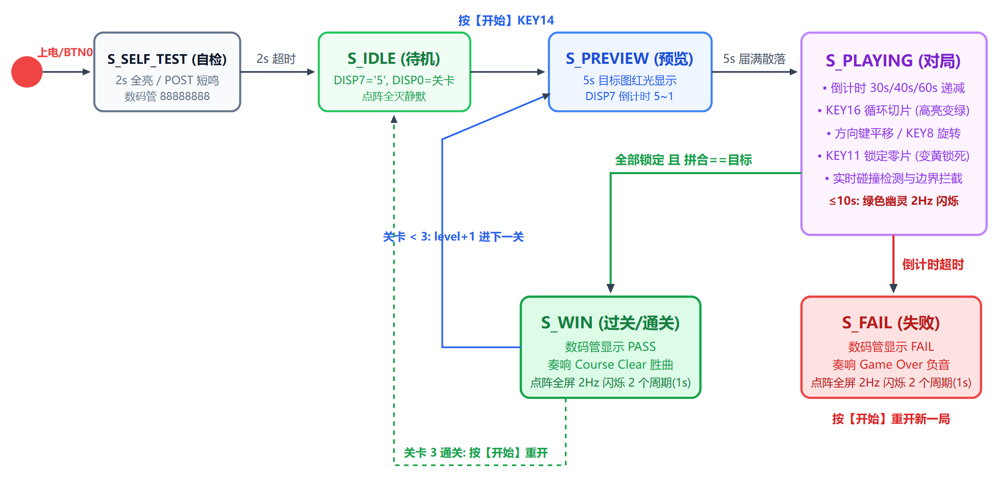
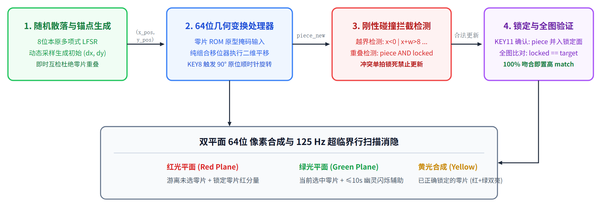

# 实际设计方案 —— 题目 4：简易拼图游戏

## 一、游戏流程

整机的决策过程如上：圆角框 = 起止，矩形 = 处理，菱形 = 判断（分支标注 是 / 否）。
自检 → 待机 → 预览 → **对局循环**（按键 → 译码执行 → 碰撞拦截 → 更新锁定 → 全图判定），
出口有三个：过关、失败、通关。对局循环的三条回边汇入一条「回循环」总线，不拉长线、不穿方框。
图中的六个状态名、三个判据信号与四个限时常量都与 `rtl/game_fsm.vhd`、`rtl/puzzle_ctrl.vhd`、
`rtl/puzzle_pkg.vhd` 逐条对账过。

## 二、设计方法：自顶向下的模块化设计

在 Altera MAX II EPM1270T144C5（1,270 LE / 127 LAB，无片上 RAM）上以纯 VHDL-93 实现，
**零软核、零微控制器**。做法：

1. **先定接口、再写实现**：顶层 `puzzle_top` 先声明 11 个 `component` 与全部内部信号，
   各子模块再由 `entity` 端口反向约束实现；顶层是**唯一**绑定引脚的文件（52 个用户引脚）。
2. **单一同步时钟域 + 使能脉冲节拍**：全系统只在 50 MHz 主时钟上升沿驱动，
   分频只产生**单周期使能脉冲**，不生成任何分频时钟。
3. **数据流解耦**：控制（状态机）、运算（拼图引擎）、存储（图案/零片 ROM）、显示与音频各自独立，
   模块间只通过单拍脉冲与位平面交换数据。

## 三、系统总体框图

**框图与实现电路（代码）的一致性**：图中**每个实线框都直接对应 `rtl/<同名>.vhd` 中的一个 `entity`（共 11 个）**；
图上的**一根线 = 一条总线**（同一个源模块出去的线共用一条主干，到各自目标再分叉），
主干的每一条分支都对应 `puzzle_top.vhd` 例化时的一行端口连接（`formal ← actual` 网名），位宽取自各
`entity` 的端口声明；**全部 32 条连接按信号组归纳在第五节的信号传递表里**。图和表都由脚本从 `facts/facts.json`
与 `puzzle_top.vhd` **自动生成并对账**（`scripts/gen_design_diagram.py --check`）。这份自检是**三道关**：

1. **数据对账**：方框集合（11 entity + 7 板载器件 + 2 顶层胶合 = 20）、11 个文件名、
   展开后的 **60 个 `(源, 目标, 网名)` 三元组**、每个模块消费的全局网络，全部与事实源逐条比对；
2. **几何体检**：`scripts/audit_diagram.py` 检查线不许穿方框、**标签不许压在连线上**、
   标签不许压框或互相重叠、方框内文字不许溢出边框、端点必须落在框边、不许越界，ERROR 必须为 0；
3. **端口名核对**：模块一览里列出的每个 `i_*` / `o_*` 端口名必须真的存在于该 `entity` 的声明里。

两个虚线框（「行计数器 + 行切片」「图案选择锁存」）不是独立 entity，而是 `puzzle_top.vhd`
内的胶合逻辑；`clk` / `rst` / `sw7` 是一对多的全局分配（消费者 8 / 8 / 4 个），逐根画会得到
20 根长线，故改用**方框左下角的角标**表达，来源与消费者在图上均可查。

## 四、各模块设计

上图逐格给出 11 个子模块的**模块功能、模块间关键接口（含位宽）与设计要点**。
其中两个最复杂的模块另附专门设计图：

### 4.1 游戏主控状态机 `game_fsm` —— 六态 ASM

六个状态（自检 / 待机 / 预览 / 对局 / 过关 / 失败）与全部跳转条件都在图上；
按键经 `key_of()` 单点译码成 8 个功能键的单拍脉冲，倒计时走 `t_1hz`、闪烁由 `t_4hz` 翻转得 2 Hz。

### 4.2 拼图核心引擎 `puzzle_ctrl` —— 四级数据流

1. **随机散落**：按零片包围盒取候选锚点，重叠则重采样（最多 15 次）；
2. **64 位几何变换**：平移与 90° 旋转都是单拍 64 位位运算；
3. **刚性碰撞拦截**：`chk_slot` / `chk_crow` / `chk_hit` 按"候选行 × 邻块"串行扫描，命中即当拍锁死坐标；
4. **锁定与全图判定**：判据是"所有零片并集 == 目标图案"（`frm_ok`），**不做**"第 k 块必须在 (x_k, y_k)"式坐标绑定。

## 五、模块间主要信号的传递关系

（源 → 信号网名[位宽] → 目的；全部与 `puzzle_top.vhd` 的 `port map` 一致）

| 源 | 信号[位宽] | 目的 | 作用 |
|:--|:--|:--|:--|
| 晶振 PIN_18 / BTN0 | `clk` / `btn` | `clk_gen` | 主时钟与复位输入 |
| `clk_gen` | `rst` | 全部时序模块 | 同步复位（20 ms 消抖） |
| `clk_gen` | `t_200` / `t_1hz` / `t_4hz` / `t_1k` | `keypad_scan` / `game_fsm` / 行计数器与 `seg_scan`、`puzzle_ctrl` | 键盘轮次 / 秒计数 / 闪烁与换音 / 行渲染与位选 |
| 矩阵键盘 ↔ `keypad_scan` | `kp_row[3:0]` / `kp_col[3:0]` | — | 行读回 / 列独热轮询 |
| `keypad_scan` | `key[3:0]`、`press` | `game_fsm` | 键号与单拍按键脉冲 |
| `game_fsm` | `go`/`sel`/`move`/`conf`/`mv_rot`、`level` | `puzzle_ctrl` | 单拍控制脉冲与关卡号 |
| `game_fsm` | `state[2:0]`、`gtime[5:0]`、`gblink` | `disp_format` | 显示状态 / 倒计时 / 闪烁使能 |
| `game_fsm` | `sound[3:0]` | `buzzer_ctrl` | 音效码 |
| `piece_rom` | `shapes[4×64]`、`shape_h`/`shape_w[4×3]` | `puzzle_ctrl` | 零片掩码与包围盒 |
| `pattern_rom` | `tgt_mask[63:0]` | `puzzle_ctrl` | 目标图案（黄金参考） |
| `rng_lfsr` ↔ `puzzle_ctrl` | `rnd_val[7:0]` / `rnd_step` | — | 随机数与推进请求 |
| `puzzle_ctrl` | `solved`、`all_lock`、`shuf_busy` | `game_fsm` | 状态迁移条件 |
| `puzzle_ctrl` | `eng_fr`/`eng_fg[63:0]` | 顶层行切片 → `dot_matrix_scan` | 红/绿平面按 `mrow[2:0]` 切成 8 位行数据 |
| `disp_format` | `disp_data[31:0]`、`disp_blank[7:0]` | `seg_scan` | 段码与熄灭掩码 |
| `seg_scan` / `dot_matrix_scan` / `buzzer_ctrl` | `seg[7:0]`+`cat[7:0]` / `dot_row`+`dot_colr`+`dot_colg[7:0]` / `buzz` | 数码管 / 点阵 / 蜂鸣器 | 板载显示与发声 |

> 说明：`clk_gen` 的 `o_tick_2hz` 在顶层**未接（`open`）** —— 2 Hz 方波由 `t_4hz` 翻转得到（省一个计数器），
> 属有意设计；`piece_rom.o_n`（本关零片数）当前未被消费，属已知遗留（对应编译报告的
> “assigned a value but never read” 警告），不影响功能。
