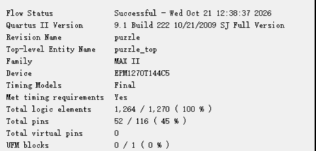
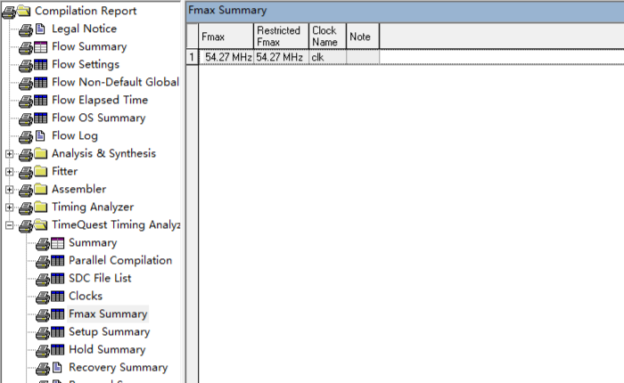
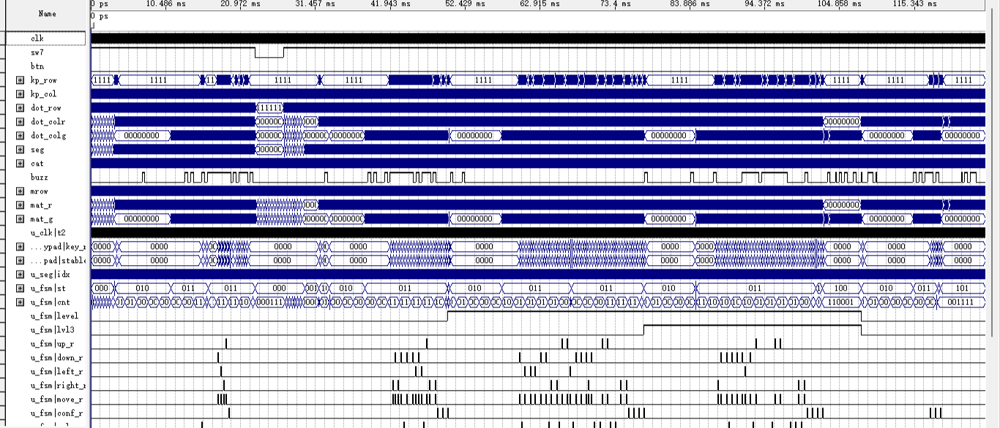

# 系统顶层集成（puzzle_top.vhd 与 puzzle_pkg.vhd）

> **一句话**：把键盘、点阵屏、数码管、蜂鸣器接到芯片管脚上，并决定点阵每格亮什么颜色。

## 1. 它管什么

- **吃进**：`clk`（1 位，PIN_18 的 50 MHz 晶振）、`sw7`（1 位，总使能）、`btn`（1 位，复位键）、`kp_row[3:0]`（4 位，4×4 键盘行线）。
- **吐出**：`kp_col[3:0]`、`dot_row[7:0]`、`dot_colr[7:0]`、`dot_colg[7:0]`、`seg[7:0]`、`cat[7:0]` 与 `buzz`，一共 52 个用户脚。
- **节拍**：全设计只有一个时钟 `clk`；`clk_gen` 分出 7 路使能脉冲，本顶层只用了 4 路（`tick_1k`、`tick_200`、`tick_1hz`、`tick_4hz`），`tick_2hz` 接 `open`。剩下两路在本顶层也没有读者，但原因不同：`tick_40` 是给另一个顶层 `board_test_top` 的板级自检用的，`tick_100` 才是全工程真的悬空（只声明、无读者，见 `rtl/clk_gen.vhd:38-40`）。
- **代价**：1,264 / 1,270 个逻辑单元（LE）、127 / 127 个逻辑阵列块（LAB）、Fmax 54.27 MHz、Setup slack +1.572 ns。
- **附带的包**：`puzzle_pkg.vhd` 只有 90 个常量和 12 个纯函数（包声明与包体各写一遍，共 24 处），没有信号也没有进程，所以不生成电路。
- **自己写的逻辑**：除了行计数器 `mrow` 和点阵配色那段 `case`，顶层其余部分都是 `port map`。

## 2. 它在系统里的位置

*系统总体框图（模块级）：实线框 = `rtl/<同名>.vhd` 里的一个实体（共 11 个），虚线框 = `puzzle_top.vhd` 内的顶层胶合逻辑，浅灰框 = 板载器件；每根箭头 = 顶层例化时的端口连接（网名[位宽]），方框左下角的角标 = 该模块消费的全局网络（`clk` / `rst` / `sw7`）。在图上找：① 左侧 `clk_gen` 产出的 `t_1k` / `t_200` / `t_1hz` / `t_4hz` 分别喂给谁 ② 键盘只连到 `game_fsm`、与拼图引擎之间没有直连线 ③ `puzzle_ctrl` 送出的 `eng_fr/eng_fg[63:0]` 经顶层行切片变成 `mat_r/mat_g[7:0]` 再进 `dot_matrix_scan` ④ `state` 这个网名为什么在图上出现了三次（分别去 `disp_format`、行切片、图案选择锁存）*

顶层自己不存画面：`puzzle_ctrl` 送来红、绿各 64 位的整帧，顶层按行计数器 `mrow` 切出当前 8 位，再按状态换成面板颜色。

键盘和引擎之间没有直连线：`keypad_scan` 只连 `game_fsm`，引擎拿到的是状态机解出来的 `sel`、`move`、`conf`、`rot` 和四个方向脉冲。

点阵配色只看 `state`：自检整屏黄、待机全灭、预览用目标图案、对局用引擎帧、胜利用绿对勾、失败用红叉。

顶层的路径都很短：54.27 MHz 这个 Fmax 由 `puzzle_ctrl` 内部的最差路径决定（`chk_slot[0]` → `chk_hit`，data delay 18.095 ns），顶层只做连线和配色。

- **上游**：`clk_gen` 送来复位 `rst` 和 7 路 tick；`keypad_scan` 把 `kp_row` 变成 `key[3:0]` 和单拍 `press`。
- **下游**：`seg_scan`、`dot_matrix_scan`、`buzzer_ctrl` 直接驱动 `seg`、`cat`、`dot_*`、`buzz` 四组外设。
- **少放它一个会怎样**：11 个子模块各自都编译得过，但没有一根线接到管脚，板子上什么都不会动。

## 3. 三个设计选择

### ① 52 个脚逐脚锁死，位序还跟管脚编号反着接

`quartus/puzzle.qsf` 里 52 条 `set_location_assignment` 把 11 类外设钉死，其余未用脚保持高阻。

每根 8 位总线都是 bit0 接编号最大的脚：`dot_row[0]`=PIN_8、`dot_row[7]`=PIN_1，所以逻辑第 0 行驱动 `dot_row[7]`，行译码在 `dot_matrix_scan` 里倒过来。

### ② 红列直通、绿列叠加，所以只有绿色会闪

红列直通引擎数据（`mat_r <= rw`），不做门控，未选中的零片不会跟着闪。

绿列是 `mat_g <= gw or (prev_row and not rw and hint_mask)`：选中零片常亮，≤10 s 时在空目标格叠一层 2 Hz 闪的幽灵。改成与门会让选中块一起灭，只能用或，代价 1 个 LUT4。

### ③ 127 个 LAB 打满，最后 6 个 LE 凑不成一组

EPM1270 是 127 个 LAB、每个 10 个 LE，正好 1,270 个。

综合后 LE 是 1,264 / 1,270（99.53%），LAB 却是 127 / 127（100%）—— LE 只能按 LAB 成组装箱，剩 6 个凑不成一组，卡死的是 LAB 不是 LE。

*Quartus Flow Summary 资源报告（在图上找：① Total logic elements 1,264 / 1,270 ② Total pins 52 / 116 ③ UFM blocks 0 / 1）*

*Quartus Fmax Summary 报告（在图上找：① Fmax 54.27 MHz ② Restricted Fmax 同为 54.27 MHz ③ Clock Name 只有 clk 一个，印证单时钟域）*

## 4. 波形怎么读

*顶层全流程波形（在图上找：① 3.424～11.200 ms 的预览红列 ② 20.992～23.000 ms 的绿色告急幽灵 ③ 77.472 ms 起的三关连闯与胜负）*

先看顶部时间轴：刻度从 0 ps 一直排到 115.343 ms，波形总长 **125.272 ms**（`sim/puzzle_top.vwf`），不先看这里就会把整条线读成秒。

这是时间压缩后的仿真：`puzzle_pkg` 的 `CLK_HZ` 被测试台从 50 MHz 补丁成 80 kHz，所以总长只有 125.272 ms，第一关时限也被补丁成 17 s（`sim/tb_puzzle_top.py`）。

这条波形跑完了：自检 → 待机 → 预览 → 对局 → 过关 / 超时，中间还夹着一次 SW7 关掉再拨回。

波形里 `u_fsm|level` 由 '0' 变 '1' 表示进了第二关；`u_fsm|up_r`、`down_r`、`left_r`、`right_r` 上一簇簇短脉冲，就是按键经状态机解出来的单拍控制脉冲。

1. **① 3.424～11.200 ms**：`mat_r` 逐行点亮 12 格的目标图案，`mat_g` 这一段恒为 '0'，说明预览只点红列。注意 0～3.200 ms 是自检段，那时 `mat_g` 和 `mat_r` 一起亮，整屏是黄的。
2. **② 20.992～23.000 ms**：`mat_g` 上多出一批按 2 Hz 闪动的格子，只落在目标图案还空着的位置；同一段 `mat_r` 的**整帧内容**不变（它是按行切出的 8 位，仍随行号在刷新）。
3. **③ 77.472 ms 起**：`u_fsm|lvl3` 由 '0' 变 '1'（进第三关）；`u_fsm|st` 在 **102.432 ms** 由 011 变 100（对局 → 胜利），到 **118.960 ms** 变 101（→ 失败），两条出口都跑到了。

## 5. 答辩问答

### Q1 你这个顶层到底干了什么？

A：三件事：接 11 个子模块、把信号绑到 52 个管脚、管点阵配色。`rtl/puzzle_top.vhd` 里除了行计数器 `mrow` 和那段配色 `case`，其余全是 `port map`。

### Q2 点阵上红、绿、黄分别是哪一块？预览的时候是什么颜色？

A：红是没选中也没锁定的零片，绿是当前选中的那一块，黄是两者同时亮的锁定块。预览时点阵全红（`mat_r <= prev_row`、`mat_g` 全 0），绿只出现在选中零片和告急幽灵上。

### Q3 倒计时最后 10 秒那个提示，为什么只有绿色闪、红色不闪？

A：因为红列直通、只有绿列叠了闪烁层。`mat_r <= rw` 不做任何门控；`mat_g` 是 `gw or (prev_row and not rw and hint_mask)`，改成与门会让选中那块一起灭，所以只能用或。

### Q4 puzzle_pkg 里那么多函数，为什么一个 LE 都不占？

A：因为包里只有常量和纯函数，没有信号也没有进程，综合时结果直接算成常数。全包 90 个常量、12 个纯函数（声明和函数体各 12 处，`facts/facts.json` 记的 24 就是这两批加起来），`rtl/puzzle_pkg.vhd` 里没有一条进程。

### Q5 1,264 个 LE、127 个 LAB 都满了，为什么还剩 6 个 LE 用不上？

A：因为 LE 只能按 LAB 成组装箱。EPM1270 是 127 个 LAB × 10 个 LE = 1,270，LAB 已满 127 / 127，剩 6 个凑不成一组，所以 `puzzle.fit.rpt` 里 LE 显示 100%。
