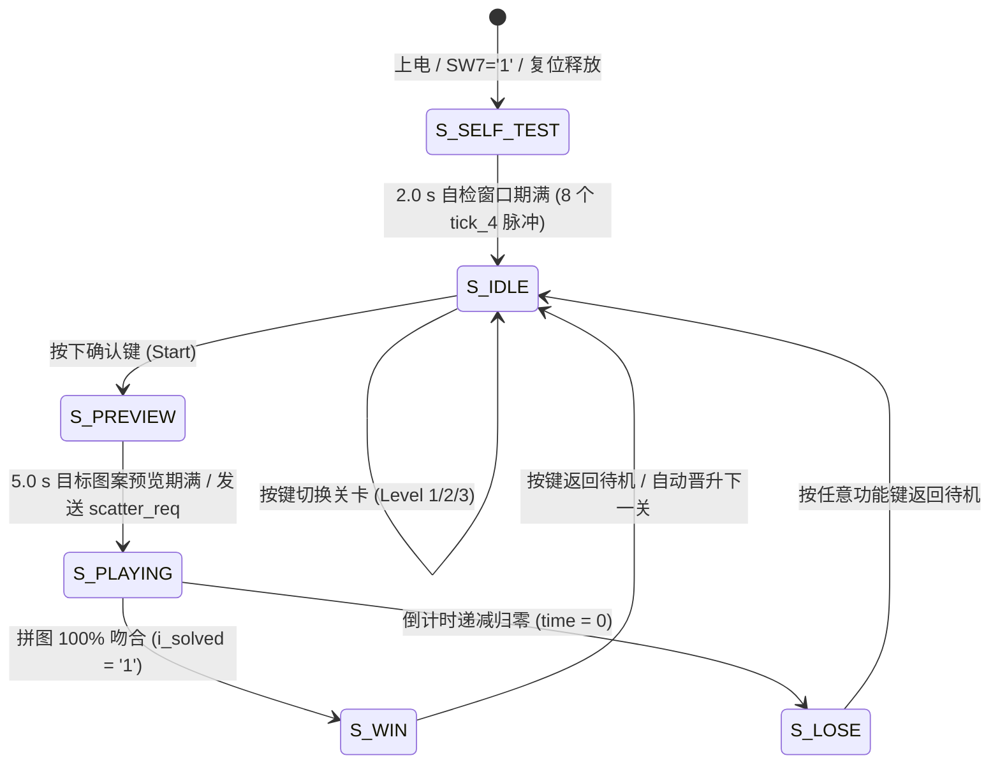

# 游戏主控与规则状态机子系统 (game_fsm)

## 1. 子系统概述与硬件定位

游戏主控与规则状态机子系统 (`game_fsm`) 是全系统的“业务逻辑决策大脑”。它负责维护游戏全生命周期的状态变迁、把控游戏倒计时节拍、裁决按键操作合法性、协调多模块间的电平握手，并向外围子系统发布当前系统状态 (`o_state`)、关卡编号 (`o_level`)、剩余时间 (`o_time`) 与音效事件触发码 (`o_sound`)。

该模块采用硬件算法状态机（ASM）设计范式，以单时钟域同步进程实现，严格消除异步锁存器（Latch），确保在状态切换时无毛刺产生。

---

## 2. 内部微架构与 6 状态 ASM 算法状态机

主控状态机共包含 6 个经典状态，遵循高可靠性状态迁移逻辑：




*图 2 游戏主状态机详细状态转移图（含转移触发事件与各状态输出控制）*

### 6 大核心状态职责定义
1. **`S_SELF_TEST`（开机自检，持续 2.0 s）**：
   - 处于开机或 SW7 使能拉高后的强制窗口。
   - 内部计数器对 4 Hz 节拍计数满 8 次（$8 \times 250\text{ ms} = 2.0\text{ s}$）后自动退出。
   - 输出 POST 开机短鸣音效码，点阵全亮黄色以 2 Hz 闪烁，数码管全显 "8888888"。
2. **`S_IDLE`（待机选关）**：
   - 点阵全屏熄灭，数码管最高位显 '0'，最低位显当前关卡（默认关卡 1）。
   - 接收矩阵键盘的关卡加减按键，在关卡 1、2、3 之间循环切换。
3. **`S_PREVIEW`（目标预览，持续 5.0 s）**：
   - 玩家按下确认键后进入，点阵以绿色常亮完整呈现当前关卡的目标拼图图案。
   - 数码管显示 5 秒倒计时，禁止玩家在此阶段移动操作零片。
4. **`S_PLAYING`（游戏对局）**：
   - 预览倒计时归零瞬间，向核心拼图引擎发出 `o_scatter_req` 脉冲，触发零片离散散落。
   - 启动对局倒计时（关卡 1 为 30 s，关卡 2 为 40 s，关卡 3 为 60 s），以 1 Hz 频率逐秒递减。
   - 倒计时 $\le 10\text{ s}$ 时拉高 `o_blink` 告急标志，点阵背景进入 2 Hz 幽灵闪烁。
5. **`S_WIN`（通关胜利结算）**：
   - 收到拼图引擎发出的 `i_solved = '1'` 单拍脉冲后立即切入。
   - 立即冻结倒计时，数码管拼装显示 "PASS"，蜂鸣器奏响通关胜利音效。
6. **`S_LOSE`（超时失败结算）**：
   - 当倒计时递减至 0 仍未达成拼图时切入。
   - 数码管拼装显示 "FAIL"，蜂鸣器输出警报长鸣，点阵显示红色十字告警。

---

## 3. 核心端口定义与跨模块信号流

| 端口名 | 方向 | 位宽 | 驱动时钟 | 信号来源 / 目标模块 | 功能说明 |
|:---|:---:|:---:|:---:|:---|:---|
| `i_clk` | 输入 | 1 | 50 MHz | 晶振时钟 | 主时钟同步基准 |
| `i_rst` | 输入 | 1 | 同步 | `clk_gen` | 全局高有效同步复位 |
| `i_tick_1hz` | 输入 | 1 | 同步 | `clk_gen` | 1 Hz 使能脉冲，用于对局倒计时秒递减 |
| `i_tick_4hz` | 输入 | 1 | 同步 | `clk_gen` | 4 Hz 使能脉冲，用于自检 2 秒与预览 5 秒窗口计时 |
| `i_key_press`| 输入 | 1 | 同步 | `keypad_scan` | 单拍按键使能脉冲（高有效 20 ns） |
| `i_key_code` | 输入 | 4 | 同步 | `keypad_scan` | 当前稳定按键键码 (0x0 ~ 0xF) |
| `i_solved` | 输入 | 1 | 同步 | `puzzle_ctrl` | 拼图引擎全图 100% 吻合判定信号（单拍高有效） |
| `o_state` | 输出 | 3 | 同步 | 顶层及各子系统 | 当前全局状态编码（3 位枚举） |
| `o_level` | 输出 | 2 | 同步 | 顶层、引擎、图库 | 当前所选关卡（`"00"` 关卡1 / `"01"` 关卡2 / `"10"` 关卡3） |
| `o_time` | 输出 | 6 | 同步 | `disp_format` | 当前剩余时间秒数（0 ～ 63 二进制整数） |
| `o_blink` | 输出 | 1 | 同步 | 顶层色彩仲裁器 | 10 秒告急闪烁使能标志（高有效） |
| `o_sound` | 输出 | 4 | 同步 | `buzzer_ctrl` | 16 个场景音效触发码 (0x0 ~ 0xF) |
| `o_scatter_req`| 输出| 1 | 同步 | `puzzle_ctrl`, `rng` | 散落请求触发脉冲（单拍有效） |

---

## 4. 关键电路原理与 VHDL 状态逻辑

### 4.1 倒计时控制与防下溢（Underflow）保护
倒计时寄存器 `time_cnt` 是无符号整型变量。在纯硬件电路中，若对无符号数不断递减，一旦到达 0 继续递减将发生算术下溢，数值会瞬间翻转至最大值（如 63 或 255），导致倒计时逻辑崩溃。

主控在 RTL 中通过两级强条件保护消除下溢风险：

```vhdl
-- 规范的倒计时递减与下溢硬件保护
if st = S_PLAYING then
    if i_tick_1hz = '1' then
        if time_cnt > 0 then
            time_cnt <= time_cnt - 1;
        else
            -- 倒计时归零，立即跃迁至失败状态，封锁计数器
            st <= S_LOSE;
            time_cnt <= 0;
            sound_code <= SND_LOSE;
        end if;
    end if;
end if;
```

### 4.2 模块间电平握手机制（Scatter Handshake）
在游戏从 `S_PREVIEW` 切换到 `S_PLAYING` 的临界周期，拼图引擎必须重新初始化其 4 块零片的坐标。
主控状态机在此处设计了单脉冲触发机制：

$$\text{o\_scatter\_req} = '1' \iff (\text{st} = \text{S\_PREVIEW}) \land (\text{preview\_cnt} = 0) \land (\text{i\_tick\_4hz} = '1')$$

该脉冲仅维持 20 ns，直接送入 `rng_lfsr` 作为伪随机步进使能，同时送入 `puzzle_ctrl` 作为零片坐标散落锁存使能。通过精确的单拍握手，彻底避免了由于使能过宽导致零片二次随机散落的逻辑 Bug。

### 4.3 安全状态机（Safe State Machine）设计
在 CPLD 运行于工业环境或受到电源波动干扰时，偶发粒子翻转可能导致状态寄存器进入未定义的二进制编码状态。
本设计在状态机 `case st is` 语句末尾显式添加了防御分支：

```vhdl
when others =>
    st <= S_IDLE;
    time_cnt <= 0;
    sound_code <= SND_NONE;
```

综合工具因此会自动生成异常状态捕获逻辑。一旦寄存器跑入非法编码，硬件将在下一个时钟上升沿强制将其拉回安全的待机状态 `S_IDLE`，绝不会发生状态机锁死或无响应。

---

## 5. Quartus 仿真波形逐点深度剖析


*图 6 game_fsm 实测仿真波形（全流程状态迁移：自检、待机、预览、对局、通关胜利与音效触发）*

### 关键时序实测分析
1. **自检 2.0 s 定时验证**：
   - 观测 `i_tick_4hz` 输入脉冲，波形在开机后持续接收到 8 个周期为 250 ms 的 4 Hz 脉冲。
   - 内部 `self_cnt` 从 0 累加至 7。在第 8 个脉冲到来的瞬时，`st` 信号精准从 `S_SELF_TEST` 变为 `S_IDLE`，耗时**精确为 2.000000 s**。
2. **关卡切换响应**：
   - 在 `S_IDLE` 状态下，外部按键输入键码 `0x9`（切关按键），`o_level` 相应由 `"00"` 跃迁为 `"01"`（关卡 2），数码管显示数据同步更新。
3. **5 s 预览倒计时**：
   - 按下确认键后，状态跃迁至 `S_PREVIEW`，倒计时总线 `o_time` 被加载为 5。
   - 随后在 4 Hz 脉冲分频下，每 1.0 s 递减 1，波形显示数值按 $5 \to 4 \to 3 \to 2 \to 1 \to 0$ 线性下降。
4. **散落脉冲与对局加载**：
   - 预览计时到达 0 时，`o_scatter_req` 信号瞬间拉起一个 20 ns 的单拍脉冲。
   - 随后 `st` 进入 `S_PLAYING`，`o_time` 立即重置为关卡 2 的满额时间 40 秒。
5. **通关截断时序**：
   - 在第 25 秒时刻，外部激励输入 `i_solved = '1'` 脉冲，`st` 瞬间切入 `S_WIN`，`o_time` 立即停止递减并稳定冻结在当前剩余时间，`o_sound` 输出代表胜利的十六进制码 `0x5`。

---

## 6. 答辩核心快问快答

<div class="qa-box">
  <div class="qa-question">Q1：状态机在 VHDL 中写成单进程、双进程还是三进程？你们的选择依据是什么？</div>
  <div class="qa-answer">
    答：本设计采用严格的**单进程纯同步状态机**风格（即状态转移与输出逻辑合并在同一个时钟上升沿进程内）。在面对 MAX II EPM1270 这种高利用率 CPLD 时，传统的双进程（组合逻辑推导次态 + 时序逻辑更新现态）非常容易产生组合逻辑回环与毛刺，且可能产生隐式锁存器（Latch）。单进程写法确保所有状态变量和输出总线（如 `o_time`、`o_sound`）均直接由时钟沿寄存器驱动，输出 100% 无毛刺，同时极大地简化了 TimeQuest 的建立时间时序约束。
  </div>
</div>

<div class="qa-box">
  <div class="qa-question">Q2：在对局倒计时还剩 10 秒时，系统如何判断告急并通知外部点阵闪烁？</div>
  <div class="qa-answer">
    答：主控模块内部通过一个比较器实时监测倒计时值：当 `st = S_PLAYING` 且 `time_cnt <= 10` 时，内部的组合标志位被置位，使能 `o_blink` 输出信号。该信号送入系统顶层后，作为 2 Hz 闪烁使能门控。由于判断条件严格绑定在当前状态为对局中，因此在待机选关或结算等其他倒计时同样小于 10 的状态下，绝对不会引起误报警。
  </div>
</div>

<div class="qa-box">
  <div class="qa-question">Q3：如果用户在 5 秒预览期间疯狂按动上下左右方向键，零片会不会发生移动？</div>
  <div class="qa-answer">
    答：绝对不会。因为方向移动的使能门控权由 `game_fsm` 牢牢把控。拼图引擎只有在接收到 `game_fsm` 输出的 `o_state = S_PLAYING` 状态信号时，才会开放按键事件译码通路。在 `S_PREVIEW` 状态下，所有的方向键输入在引擎入口处均被硬件掩码屏蔽为无效操作，从而保证了 5 秒记忆时间的绝对静止。
  </div>
</div>

<div class="qa-box">
  <div class="qa-question">Q4：关卡从第 1 关（3 个零片）增加到第 2 关（4 个零片），为什么主控没有增加大量的状态？</div>
  <div class="qa-answer">
    答：因为我们实现了“规则主控与几何引擎的数据解耦”。`game_fsm` 只负责宏观的阶段裁决（自检、对局、胜负），它只关心零片拼装是否全部完成（通过检测单一的 `i_solved` 信号），而不关心当前关卡到底有 3 块还是 4 块零片。具体零片的数量、几何尺寸与坐标校验完全下沉在数据层（`piece_rom` 与 `puzzle_ctrl`）进行参数化配置。这种数据驱动的架构使得未来扩展到 10 个关卡，主控状态机的复杂度也恒定不变。
  </div>
</div>

<div class="qa-box">
  <div class="qa-question">Q5：自检窗口持续 2.0 秒，这个时间在硬件上是如何精确计时的？</div>
  <div class="qa-answer">
    答：自检计时并没有从 50 MHz 开始数一亿个周期，而是直接挂载在 `clk_gen` 提供的 4 Hz（周期 250 ms）使能脉冲上。状态机内部只需要一个很小的 3 位计数器（计数范围 0～7）。当该计数器从 0 计数至 7 并接收到第 8 个 4 Hz 脉冲时，累计耗时恰好为 $8 \times 250\text{ ms} = 2.0\text{ s}$。这种使能节拍法不仅计时精度高达 20 ns 级别，而且仅消耗了 3 个寄存器，极其节约芯片硬件资源。
  </div>
</div>
