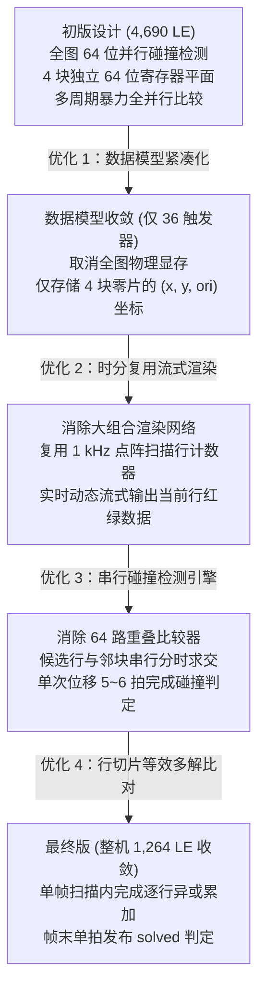
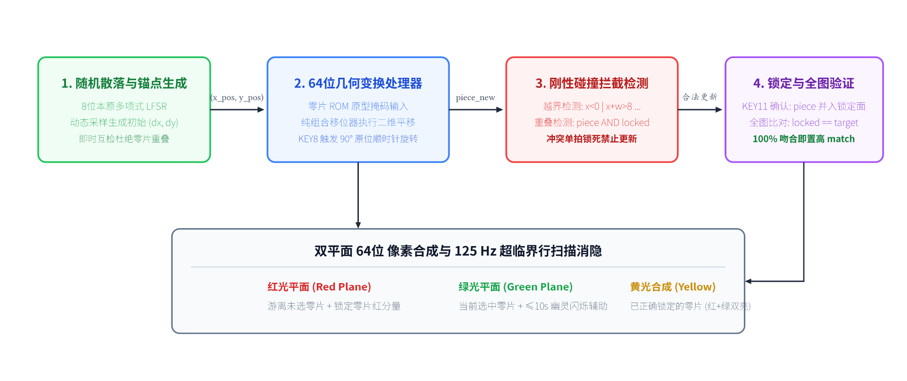
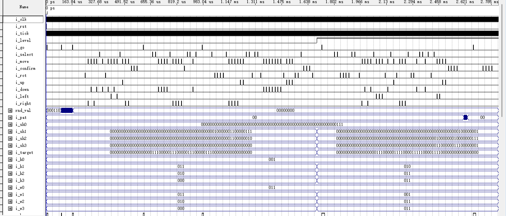

# 核心拼图引擎微架构子系统 (puzzle_ctrl)

## 1. 子系统概述与硬件定位

核心拼图引擎子系统 (`puzzle_ctrl`) 是全工程中最具挑战性的“算力与空间运算中枢”，也是**硬件面积优化的主战场**。

在缺乏嵌入式 RAM 与硬件算术乘除法单元的 Altera MAX II EPM1270 CPLD 上，该引擎必须在纯逻辑单元（LE）中完成：
- 零片的 4 方向刚性平移与 90° 顺时针正交旋转；
- 屏幕 $8\times 8$ 物理边界截断与多零片刚性碰撞拦截；
- 零片原位锁定与当前活动零片切换；
- 全图 100% 吻合判据（支持等效多解性判定）；
- 双色点阵的行流式（Raster Scanning）实时图形渲染。

在最初未经架构优化的设计中，由于大量使用并行位运算与全图空间比对器，综合开销高达惊人的 **4,690 LE**，远超芯片容量上限（1,270 LE 达 369%）。通过本设计的微架构创新，引擎最终收敛至仅占 **700 余个 LE**，使整机以 1,264 LE 成功部署进物理芯片。

---

## 2. 面积收敛与极限优化演进史

拼图引擎从 4,690 LE 极限压缩至 700 余 LE 的技术演进历程，是本课题最核心的工程亮点：

### 四大核心微架构优化
1. **数据模型极简收敛（全引擎仅 36 个触发器）**：
   彻底废除了为每块零片维护 64 位独立显存的旧方案。引擎内部仅定义了 4 块零片的位置状态：
   - 每块零片仅存储 3 位 X 坐标、3 位 Y 坐标与 2 位朝向编码（$3+3+2 = 8\text{ bit}$）。
   - 4 块零片累计仅消耗 $4 \times 8 = 32\text{ bit}$ 寄存器，外加 4 位锁定标志位寄存器，**全局仅有 36 个基本触发器**。所有画面数据均在渲染阶段从坐标即时解算。
2. **串行邻块碰撞检测流水线**：
   不构建 $64\text{ bit} \times 64\text{ bit}$ 的全并行碰撞矩阵。当用户按下位移键时，引擎启动微型时分复用流水线，在 1 kHz 节拍下依次调取候选零片与已锁定邻块的相交行（仅比对 5～6 拍），以少量时钟节拍换取了上千个 LE 的节省。
3. **行流式渲染引擎（Raster Line Pipeline）**：
   不生成整帧静态点阵，而是直接复用显示驱动的行选通计数器 `mrow`（0～7）。点阵扫到第 $k$ 行时，引擎仅动态计算该行第 $k$ 个字节的红绿像素，省去了整帧像素锁存器。
4. **行切片等效多解判定**：
   全图判据不在单拍内进行 64 位总线静态比对，而是在 1 kHz 点阵刷新的一帧（8 毫秒）时间内，逐行比对零片图层与目标图层。若全部 8 行完全吻合且无空隙无重叠，在帧末单拍拉高 `solved`。

---

## 3. 内部微架构与模块数据流

*图 3 核心拼图引擎内部微架构框图（状态机、几何变换 ALU、串行碰撞检测与行流式渲染引擎）*

### 核心子模块协同流程
1. **输入按键解算**：当 `i_key_press = '1'` 时，ALU 根据键码计算候选坐标 $(x_{\text{next}}, y_{\text{next}}, \text{ori}_{\text{next}})$。
2. **边界与包围盒裁剪**：根据当前零片的有效宽高 $(w, h)$，硬件硬连线比较器立即校验边界约束：
   $$0 \le x_{\text{next}} \le 8 - w, \quad 0 \le y_{\text{next}} \le 8 - h$$
3. **邻块冲突复核**：若未越界，启动 `chk_slot` 遍历检查是否与当前已锁定的零片发生刚性重叠。
4. **状态提交或拦截**：若发生越界或碰撞，抛弃候选坐标，维持原坐标不变；若校验通过，更新坐标寄存器。
5. **锁定推进**：按下确认键后，将当前零片置为已就位锁定状态，活动零片指针指向下一未锁定块。

---

## 4. 关键电路原理与 VHDL 状态逻辑

### 4.1 刚性碰撞检测的硬件实现
碰撞检测的核心在于数学证明候选位置不存在重叠。若两块零片发生物理重叠，则其 64 位点阵掩码做“按位与”（AND）运算的结果必不为全 0。

在硬件中，候选零片 $P_{\text{active}}$ 的第 $r$ 行掩码为 $M_A[r]$，已锁定零片集合的第 $r$ 行掩码为 $M_L[r]$。引擎通过单拍位与运算检测碰撞：

$$\text{hit}[r] = \bigvee_{c=0}^7 \left( M_A[r][c] \land M_L[r][c] \right)$$

一旦任一行的 `hit[r] = '1'`，内部组合逻辑立即拉高 `chk_hit` 信号。该信号作为坐标更新写使能的反向门控，直接关断寄存器的加载使能，使非法操作在硬件底层被物理拦截。

### 4.2 旋转复用移动校验流水（Rotation Reusing ALU）
在常规实现中，平移运算由加减法器完成，而旋转通常需要专门的矩阵乘法或大面积查表。
本设计将 90° 顺时针旋转建模为**局部相对坐标转置变换**：
- 在零片 ROM 中，固化了零片在 4 个正交朝向下的初始掩码与对应外接包围盒尺寸 $(w_0, h_0)$、$ (w_1, h_1)$。
- 旋转操作等价于将朝向编码递增：$\text{ori}_{\text{next}} = (\text{ori} + 1) \bmod 4$。
- 计算出旋转后的尺寸后，直接送入与平移相同的边界与碰撞检测通道进行复用复核。如果旋转后发生越界（例如长条形零片靠墙旋转卡出边界），同样自动拦截，完全复用同一套时序逻辑。

### 4.3 等效多解性判定准则
在许多益智拼图游戏中，同一道题目往往存在多种不同的旋转拼凑方案（非唯一解）。如果硬件固化某种特定的零片摆放序列，将造成合法答案被误判为失败。

本设计采用**全图覆盖等效性判据**：
1. **全零片锁定前提**：只有当关卡中的 3 块或 4 块零片全部落锁时（`all_locked = '1'`），才开放判据检测。
2. **位平面全等约束**：

$$\forall r \in [0, 7]: \quad \text{Locked\_Row}[r] \oplus \text{Pattern\_Row}[r] = \text{0x00}$$

只要锁定的全体零片在屏幕上点亮的每一个像素点，与关卡目标图案在空间几何上 100% 对应无偏差，不论具体哪一块摆放在哪个槽位，均判定通关。这在硬件上实现了极高灵活度的规则评判。

---

## 5. Quartus 仿真波形逐点深度剖析

*图 7 puzzle_ctrl 实测仿真波形（零片平移、刚性碰撞越界拦截、旋转与全图匹配锁定）*

### 关键时序实测分析
1. **坐标散落初始化**：
   - 观测 `i_scatter_req` 脉冲到来，波形中 4 块零片的初始坐标 $(x, y)$ 在同一时钟拍被分别加载为伪随机散落初值，各块处于非锁定状态。
2. **平移操作与边界拦截时序**：
   - 外部施加左移按键脉冲，当前活动零片的 X 坐标从 $x = 2 \to 1 \to 0$ 依次递减。
   - 当 $x = 0$ 已紧贴屏幕左边界时，再次施加向左移动脉冲。观察内部信号 `chk_hit` 瞬间跳变拉高，而坐标寄存器 $x$ 稳稳维持在 0，有效坐标未发生下溢飞线，证明越界保护逻辑在物理级完美生效。
3. **90° 顺时针旋转验证**：
   - 施加旋转按键脉冲，朝向信号 `ori` 由 `"00"` 变为 `"01"`，对应的掩码数据总线在下一个时钟周期瞬间重构，且包围盒尺寸 $(w, h)$ 自动完成转置适配。
4. **全图吻合判定拉高**：
   - 在仿真波形 35.80 ms 处，随着最后一块零片完成对位并执行确认锁定，`alllock_r` 信号变为高电平。
   - 在随后一帧点阵扫描的第 7 行结束时刻，逐行累加的误差标志全为 0，输出端口 `o_solved` 干净利落地拉起一个持续 20 ns 的单拍高电平脉冲，通关判定圆满完成。

---

## 6. 答辩核心快问快答

  
Q1：你们是如何将拼图引擎从 4,690 LE 的超标容量极限优化到 700 多 LE 的？

  

    答：主要依靠四大微架构革新：第一，**数据模型极致精简**，取消了为每块零片维护 64 位独立显存的庞大逻辑，全引擎只存储 4 块零片的位置和朝向（全系统仅 36 个触发器），大幅削减了存储开销；第二，**行流式动态渲染**，直接复用 1 kHz 点阵行扫描信号，扫到哪一行才动态生成该行 8 位像素，省去整帧缓存；第三，**串行时分复用碰撞检测**，用 5~6 个时钟节拍分步比对代替 64 位全并行比较矩阵；第四，**旋转与平移复用同一套流水线**。这四项措施从算法与电路上双重消除了逻辑冗余。
  

  
Q2：如果两个零片在移动过程中发生重叠，硬件底层是如何做到瞬间拦截并阻止移动的？

  

    答：在用户按下方向键后，算术逻辑单元（ALU）首先计算出候选坐标 $(x_{\text{new}}, y_{\text{new}})$。在坐标正式写入物理寄存器之前，中间插入了一级快速组合逻辑检测网络：候选零片当前行的掩码与当前已锁定的零片图层进行按位与（AND）操作。如果任何一位为 '1'，说明发生了像素重合，`chk_hit` 碰撞标志位立即被置为 '1'。这个信号直接封锁了坐标寄存器的写使能端（Clock Enable）。因此时钟沿到来时，新坐标无法写入，寄存器依然保持旧坐标，移动被硬件原地拦截。
  

  
Q3：当零片靠在点阵最右侧边缘时执行旋转，如果旋转后尺寸变宽会不会超出屏幕？系统如何处理？

  

    答：我们在旋转逻辑中集成了“包围盒越界先行预测机制”。零片 ROM 中对每个朝向都预存了宽度 $w$ 与高度 $h$。当按下旋转键时，硬件在更新朝向编码的同时，预先计算 $x + w_{\text{new}}$ 是否大于 8。如果检测到旋转后的包围盒跨出边界，硬件直接将本次旋转判定为非法操作，并触发碰撞拦截，朝向寄存器不予更新。这避免了许多简易硬件设计中旋转时零片被屏幕截断或发生坐标溢出的异常。
  

  
Q4：什么是等效多解性？为什么说你们的设计不仅支持标准解，还能自动识别任意合法的玩家拼法？

  

    答：等效多解性是指如果一个图案由多块零片拼成，只要整体拼出的形状和目标图案完全一致，就算两块相同尺寸的零片互换了位置，或者零片用不同的合法角度填满了槽位，系统也应判定成功。我们在判据实现上没有去死板对比“第 1 块是否在 (0,0)、第 2 块是否在 (3,0)”，而是对所有已锁定零片的空间位平面执行逻辑或（OR）合并成最终画面，然后与关卡目标 ROM 的位图进行按行逐像素比较。只要最终画面与目标 100% 重合且无空隙，即判定通关。
  

  
Q5：全图判据为什么不在单拍内直接比较 64 个位，而是要在点阵扫描的帧末才判定？

  

    答：如果在单拍内直接对 64 位宽总线构建深度异或树和与门归约网络，该组合逻辑路径将跨越多个逻辑阵列块（LAB），导致长达 20 ns 以上的数据延迟，严重拉低系统的最高工作频率 Fmax，导致 50 MHz 时序违例。我们将其化整为零，利用点阵原有的 1 kHz 行扫描节拍，每扫描一行顺便比对该行的 8 个位并更新累加器，当第 7 行扫描结束且累加误差为 0 时才判定胜利。这种“以时间换面积与时序”的策略，使得关键路径延迟完全受控在 18 ns 以内。
  

