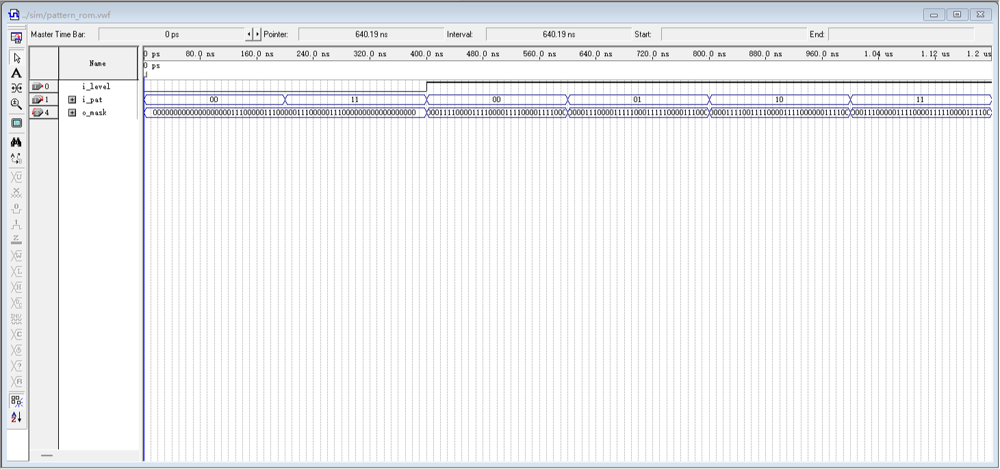
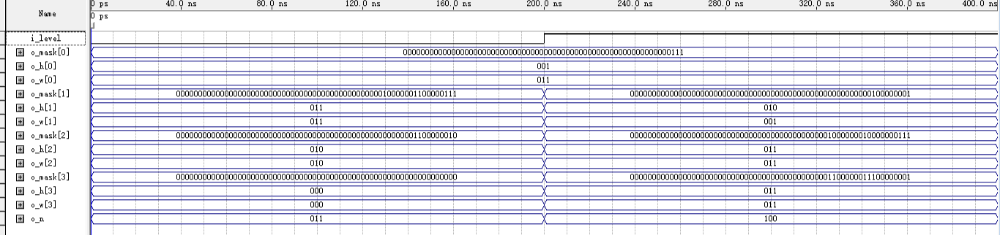

# 图案库与随机数（pattern_rom / piece_rom / rng_lfsr）

> **一句话**：它给游戏三样东西：目标图案、每块零片的外形和开局的随机位置。

## 1. 它管什么

- **吃进**：游戏主控的 `i_level`（1 位关卡号）与顶层的 `i_pat`（2 位图案下标）；拼图引擎的 `i_step`（1 位，就是 `rnd_step`）。
- **吐出**：`o_mask`（64 位目标图案）；4 块零片的 `o_mask`（各 64 位）、`o_h` 与 `o_w`（各 3 位）、`o_n`（3 位）；还有 `o_val`（8 位随机数）。
- **节拍**：两个 ROM 是纯组合逻辑（不等时钟，输入一变输出就变）；`rng_lfsr` 挂在 50 MHz `i_clk` 上，只在 `i_step` 为 '1' 的那一拍推进一步。
- **代价**：`rng_lfsr` 14 LE、8 个寄存器（`puzzle.fit.rpt` 层次表；`map.rpt` 上显示 15 个 logic cell，两个报告口径差 1）；`piece_rom` 被常量折叠成 0 个 LE，`pattern_rom` 加图案库那次只多 4 个 LE。
- **图案账**：第一关固定 1 幅 12 格，`i_level='0'` 时 `i_pat` 直接被忽略；第二关恒锁 `L2_FIXED_PAT`（PAT3 阶梯）；第三关才从 4 幅 16 格图案里随机选。
- **面积账**：零片 3+6+3 = 12 格、3+2+5+6 = 16 格，与对应图案的格数逐格对得上。

## 2. 它在系统里的位置

*图案库查表波形：`i_level` 与 `i_pat` 两路输入，决定送出去的 64 位目标掩码*

- **上游**：游戏主控给 `i_level` 与 `lvl3`，顶层的 `pat_sel` 锁存进程给 `i_pat`，拼图引擎给 `i_step`。
- **下游**：`tgt_mask` 送给预览显示与整帧判据；4 组零片掩码与宽高送给拼图引擎；`o_val` 的低 6 位拿去算散落锚点。
- **第二关与第三关的分工**：`pat_sel` 在进入预览的下一拍锁存，所以第二关每次都抽到同一幅，第三关重开一局会换。
- **时钟域**：三个实体里只有 `rng_lfsr` 挂时钟，两个 ROM 是纯组合，它们之间不需要握手。
- **少放它一个会怎样**：预览画面没有图案可显示，引擎不知道每块零片占多大，开局也散不开位置。

## 3. 三个设计选择

### ① 零 RAM 的 CPLD 上，图案就是 LUT

EPM1270 是 CPLD，芯片里没有存储块（片上 UFM 0 / 1）。FPGA 可以拿存储块放大表格，这里没有，只能让 Quartus 把常量折成组合逻辑。

`pattern_rom` 整个架构体只有一条 `when/else` 赋值（`rtl/pattern_rom.vhd` 第 46 行），`piece_rom` 是一段 `if/else` 常量表：前者折成一个 4 选 1 选择器，加 4 幅图案库那次整机只多 4 个 LE；后者被折成 0 个 LE。

面积不是花在"存储"上：整机 1,264 / 1,270 LE（99.53%）、127 / 127 LAB 全占满，大头在拼图引擎。

代价是图案改一次就要重编译一次 —— 它是常量，不是运行时可写的表。

### ② 零片只给一个 3×3 的盒子

每块零片都装得进 3×3 的包围盒（`PIECE_MAX_DIM` = 3，框住零片的最小矩形），`piece_rom` 随掩码一起给出 `o_h` 与 `o_w`。

有了宽高，引擎判越界只算一句 `(cr + hh <= 8) and (cc + ww <= 8)`（`rtl/puzzle_ctrl.vhd` 第 850 行），不用去扫 64 个点；90° 旋转也不在 ROM 里查表，由 `rot_row` 在盒子里现算。

面积账对得上：第一关 3+6+3 = 12 格 = 图案 12 格；第二/三关 3+2+5+6 = 16 格 = 四幅图案各 16 格。

`o_n` 顺便告诉引擎本关用几块：第一关 3 块（第 4 槽的掩码全 0），第二/三关 4 块。

### ③ 抽头取 7/5/4/3，反馈只有一棵异或树

代码是 `fb := sr(7) xor sr(5) xor sr(4) xor sr(3)`，再 `sr <= sr(6 downto 0) & fb`：4 个抽头先异或成一位、再整体左移一位，即 x^8+x^6+x^5+x^4+1，满周期 2^8 − 1 = 255。

教科书里 Fibonacci 把抽头异或成一位送回最低位、Galois 把最高位广播到各级；报告第 139 行记的是 Galois，源码这一句却是"多对一"写法，反馈只过一棵 4 输入异或树，8 级寄存器之间是直连，路径不随位数加深。

全零是吸收态（0 异或 0 还是 0），两道防护：复位装 `0x5A`；步进时算出的下一个状态若是 `00000000`，当拍重装 `0x5A`。

另外它不自由跑：只在 `i_step` 为 '1' 的那一拍推进一步，散落才可复现。

## 4. 波形怎么读

*LFSR 满周期波形（时间轴 0～5.76 µs；在图上找：① `i_rst` 释放 ② `i_step` 的高电平窗 ③ 复位脉冲把 `o_val` 拉回种子）*

1. **① 0～100 ns**：`i_rst` 由 '1' 跳到 '0'（复位释放），`o_val` 停在 `01011010`，说明种子 `0x5A` 已经装进去了。
2. **② 120～5215 ns**：`i_step` 由 '0' 跳到 '1' 并保持 5095 ns，正好盖住 255 个 20 ns 的时钟沿；
   `o_val` 每拍换一个值，跑满 255 拍后回到 `01011010`。
3. **③ 5480 ns 起**：`i_rst` 又跳成 '1' 并保持 40 ns，`o_val` 由 `10110100` 变回 `01011010`；
   这是第二次复位，证明复位那一路真的被激励过。

*零片形状库波形（时间轴 0～400 ns：关卡号一换，四块形状与宽高就一起换）*

**零片这一路**：200 ns 处 `i_level` 由 '0' 跳到 '1'，`o_n` 从 `011` 变成 `100`（3 块变 4 块），
`o_h`、`o_w` 由 [1,3,2,0] / [3,3,2,0] 换成 [1,2,3,3] / [3,1,3,3]；
前半段第 4 槽的 `o_mask[3]` 全 0，说明那一槽本关根本不用。

## 5. 答辩问答

### Q1 MAX II 里面一个 RAM 块都没有，你这些图案和零片到底存哪儿了？

A：没存，就是组合逻辑。`pattern_rom` 只有一条 `when/else` 赋值（`rtl/pattern_rom.vhd` 第 46 行），Quartus 折成常量，`piece_rom` 0 个 LE。

### Q2 `i_pat` 是几位？第二关和第三关的图案分别是怎么定的？

A：2 位，只有 4 个取值。第一关 `i_level='0'` 时 `i_pat` 被忽略，第二关恒锁 `L2_FIXED_PAT`（PAT3 阶梯），第三关才用 `rnd_val(1 downto 0)` 随机选。

### Q3 随机数只有 1～255，坐标只要 0～7，你是怎么映射的？用除法器了吗？

A：没用除法器。`rnd_val(2 downto 0)` 当行、`rnd_val(5 downto 3)` 当列，上界 `9 - hh`，够减就减一次就是取模。

除法器那版 44.77 → 36.68 MHz，改完回到 50.06 MHz。

### Q4 你这个 LFSR 的抽头是哪几位？多项式写一下。

A：抽头是 bit7/5/4/3，`fb := sr(7) xor sr(5) xor sr(4) xor sr(3)`，即 x^8+x^6+x^5+x^4+1，周期 255；`tb_rng_lfsr` 断言②比过 256 个状态。

### Q5 万一它跑到全 0 卡住了怎么办？

A：两道防线。复位时 `i_rst` 为 '1' 装 `SEED_DEFAULT`（`0x5A`）；步进时算出的下一个状态 `(sr(6 downto 0) & fb)` 若是全 0，当拍重装 `0x5A`。
